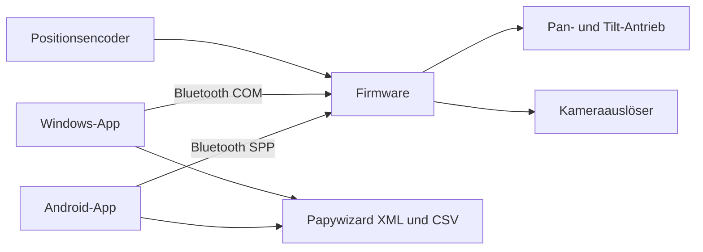

# PanoramaSoftware

[English overview](README.md) · [English short manual](docs/en/manual.md)

Steuerung eines motorisierten Pan-/Tilt-Panoramakopfes: Arduino-Firmware, Android-App und Windows-App. Die Firmware führt übertragene Aufnahmepläne autonom aus; die Apps planen, bedienen, überwachen und archivieren die Aufnahmen.

**[Gesamtdokumentation öffnen](docs/README.md)** — Architektur, Bedienabläufe, Funktionen, Variablen, Motorparameter, Protokoll, Diagramme, Tests und bekannte Probleme.

| Komponente | Dokumentierter Stand am 27.10.2026 |
|---|---|
| Firmware PanoDuinoControl | 2.4.75, festgehaltene reguläre Nano-R4-Bluetooth-Referenz |
| Android PanoramaControl | 0.6.27, VersionCode 40 |
| Windows PanoramaControl | 27.5.4, WinForms / .NET Framework 4.8 |
| Gespeichertes Motorprofil | Revision 40, gezielte Pan-Korrektur; Revision 39 als Rückfallstand erhalten |
| Drahtprotokoll | V2; Rasterrezept Version 1, sphärisches Rezept Version 2 |

Die Dokumentation beschreibt den angegebenen Softwarestand und seine Prüfgrenzen. Die Komponenten haben unterschiedliche Funktionsstände; [Funktionsmatrix](docs/08-funktionsstand.md) und [offene Probleme](docs/09-probleme-und-roadmap.md) gehören zur technischen Beschreibung.

Die aktuelle Pan-Abstimmung ist mit **96 realen Aufnahmen** geprüft: Pan maximal **0,236°**, Median **0,089°**. Der 72er-Lauf enthielt 13 Zielverfehlungswarnungen; Firmware und Android-Version bleiben unverändert. [Korrektur, vollständiges Profil und Messgrenzen](docs/validation/2026-10-27-pan-positioning.md).

Android und Windows sind alternative Bedienclients. Ein gleichzeitiger Zugriff beider Apps auf denselben Kopf ist kein unterstützter Betriebsablauf.

## Repository

- [Android](PanoramaAndroid/README.md) liegt im Hauptrepository.
- [Firmware-Repository](https://github.com/TomNaiser/PanoDuinoControl) ist als `PanoduinoControlGitRepo` eingebunden.
- [Windows-Repository](https://github.com/TomNaiser/PanoramaControl) ist als `PanoramaControlGitRepo` eingebunden.
- [Öffentliche Prüfergebnisse](docs/validation/README.md) fassen die Nachweise und ihre Grenzen zusammen.

Checkout mit Unterprojekten: `git clone --recurse-submodules <URL-dieses-Repositories>`.

GitHub stellt die eingebetteten Mermaid-Blöcke direkt dar. [Veröffentlichung und Pflege](docs/11-github-und-dokumentationspflege.md) erklären Querverweise, Unterprojekte und die Prüfung der Dokumentation.

## Lizenz

Android und die eigenen Inhalte dieses Hauptrepositorys stehen unter [MIT](LICENSE), Copyright (c) 2026 TomNaiser. Firmware, Windows und Fremdkomponenten behalten ihre jeweiligen Lizenzen; die [Lizenzzuordnung](LICENSES.md) beschreibt die Grenzen und Hinweise.
