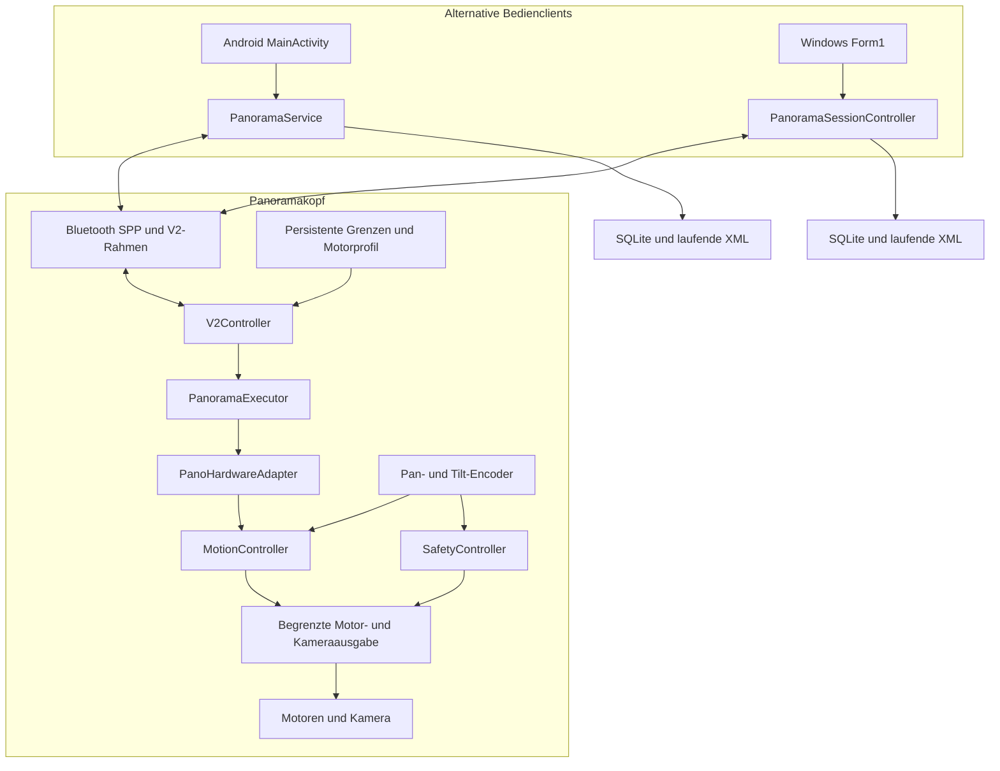

# 01 — Systemübersicht

[Inhalt](README.md) · [Nächstes Kapitel](02-bedienung-und-acquise.md)

## Aufgabe und Verantwortungen

Der Kopf richtet eine Kamera in Pan und Tilt aus und löst sie elektrisch aus. Die Apps berechnen ein Raster oder ein sphärisches Rezept aus Kamera-/Objektivdaten, Überlappung und Endpunkten. Die Firmware übernimmt nach dem Laden Zielberechnung, Bewegung, Ruheprüfung und Triggerfolge. Deshalb wird nicht jedes Bild durch einen einzelnen App-Fahrbefehl gesteuert.

Die Firmware ist die maßgebliche Quelle für laufenden Zustand, Zähler, Position und Grenzen. Die App ist verantwortlich für verständliche Bedienung, bestätigte Freigaben, langfristiges Aufnahmejournal und Export. Ein Protokoll-ACK bestätigt die Annahme eines Kommandos; eine Motorankunft wird separat aus Gerätezustand und Abschlussmeldung ermittelt.

## Aktiver Aufbau und Schnittstellen

| Teil | Aktuelle Implementierung |
|---|---|
| Controller | Arduino Nano R4 als aktuelles Entwicklungs-/Prüfziel; alter Nano/AVR mit kleinerem Speicherbudget im Code berücksichtigt |
| Positionsgeber | AS5048B über I2C, Pan `0x41`, Tilt `0x40` |
| Motoren | PWM plus getrennte Richtungsleitungen, Encoder-Rückführung am Abtrieb |
| Kamera | Elektrische Fokus-/Shutter-Ausgänge; keine Rückmeldung, ob eine Bilddatei gespeichert wurde |
| Funk | Klassische serielle Bluetooth-SPP-Verbindung; Firmware-UART mit 57.600 Baud |
| Windows | Virtueller Bluetooth-COM-Port; .NET Framework 4.8 / Windows Forms |
| Android | RFCOMM-Bluetooth-Socket, Android-Service und native Activity, minSdk 26 / targetSdk 35 |
| Austausch | Papywizard XML und Capture-Manifest CSV; kein integrierter Bildtransfer oder Stitcher |

Die H-Brücken-/Encoderverdrahtung muss zum Sketch passen. Der aktuelle Sketch definiert Pan-PWM an D3, Tilt-PWM an D9, Pan-Richtung D2/D4, Tilt-Richtung D11/D12, Lumix-Shutter D7/D8 und Sony-Shutter/Fokus D5/D6. Dies ist die Softwarebelegung und keine neue elektrische Vermessung des Boards.

## Koordinaten und Referenzen

| Größe | Vertrag |
|---|---|
| Drahtwinkel | Vorzeichenbehaftete ganze Milligrad (`mdeg`), 1.000 = 1° |
| UI-Pan | Positiv nach links; `devicePan = -uiPan` |
| UI-Tilt | Positiv hebt das Objektiv; `deviceTilt = uiTilt` |
| Tilt-Nullpunkt | Verschiebt die numerische Referenz, nicht die physische Lage gespeicherter Endanschläge |
| Regler intern | Bewegungs-/Geschwindigkeitsrechnung überwiegend `double` in Grad und Grad/s |
| Tempo | Profil-/Geschwindigkeitsvorgabe in Promille; kein PWM-Prozentsatz |
| XML | `yaw = -devicePan/1000`, `pitch = deviceTilt/1000`; Roll-Konvention der jeweiligen App beachten |

Firmware-Standardgrenzen in Rohreferenz: Pan −180° bis +180°, Tilt −45° bis +50°. Die äußersten konfigurierbaren Tilt-Rohgrenzen sind −50°/+55°. **Tatsächlich wirksam sind die vom Gerät gemeldeten, gegebenenfalls enger gespeicherten Grenzen**, nach Tilt-Nullpunkt umgerechnet. Im dokumentierten Versuch waren etwa −45°/+30° wirksam. Code-Defaults, gespeichertes Profil und konkreter mechanischer Aufbau dürfen nicht gleichgesetzt werden.

## Quellen und historische Pfade

| Verzeichnis | Rolle |
|---|---|
| `PanoduinoControlGitRepo/PanoDuinoControl/` | Aktive Firmware mit modularer V2-Steuerung |
| `PanoramaAndroid/app/src/main/java/de/tomnaiser/panoramaandroid/` | Aktive Android-Implementierung |
| `PanoramaControlGitRepo/PanoramaControl/` | Windows, aktives Projekt `PanoramaControl Version 27.csproj` |
| `docs/validation/` | Öffentliche Zusammenfassungen der Prüfungen und ihrer Grenzen |
| `analysis/` | Lokale Messreihen und Auswertungen, nicht Teil des öffentlichen Repos |
| `Sicherungen/`, `fallback/` | Lokale Sicherungsstände, nicht Teil des öffentlichen Repos |
| `I2C-Diagnose*` | Gesonderte Diagnose-Sketches, keine Panorama-Firmware |

Die Programme synchronisieren ihre lokalen Archive nicht automatisch. Nach einem Clientwechsel kann der neue Client den laufenden Geräteplan übernehmen; vergangene Istpositionen aus dem Archiv der anderen App erscheinen dadurch nicht automatisch auf dem neuen Client.
