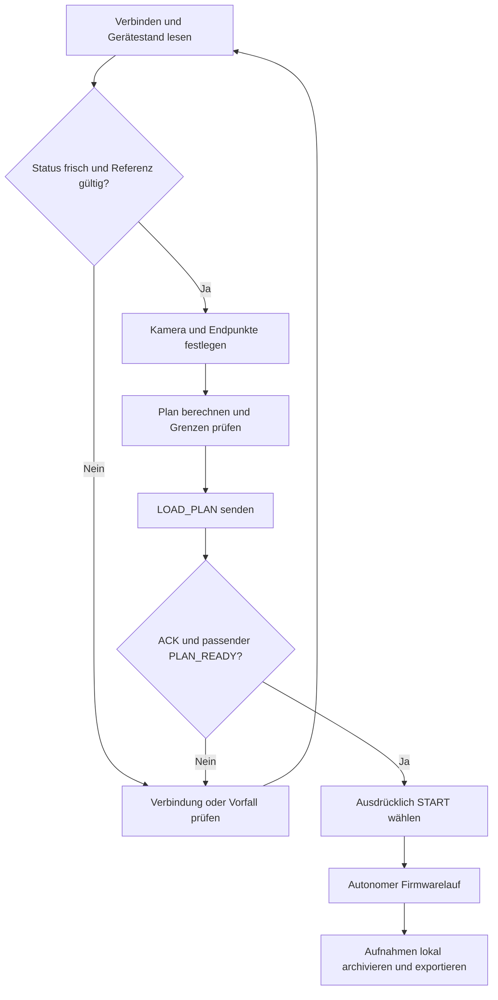
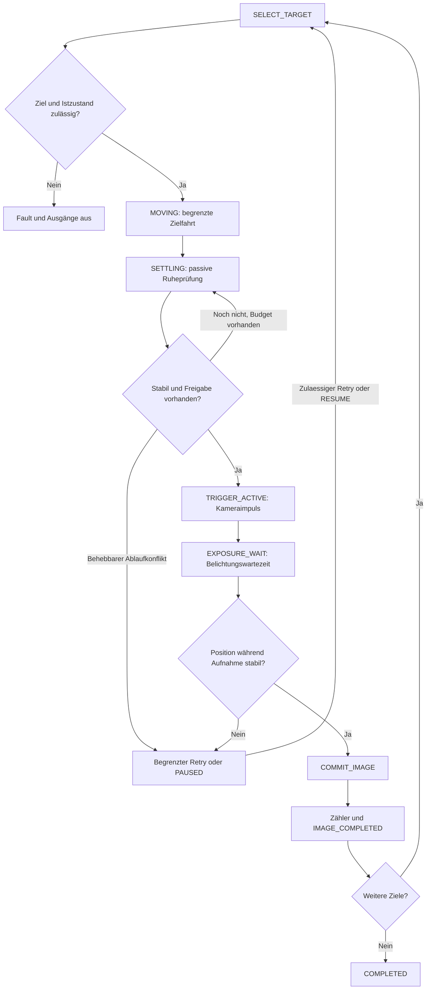
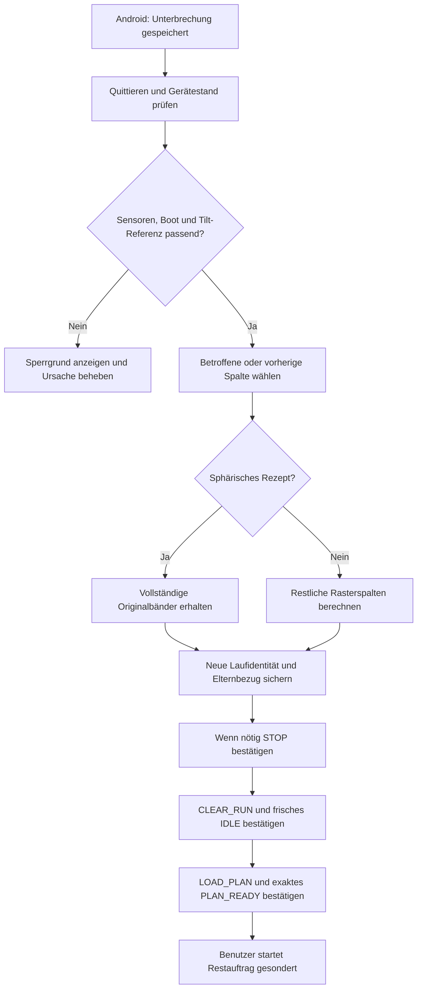

# 02 — Bedienung und Acquise

[Inhalt](README.md) · [Firmware](03-firmware.md)

## Normaler Bedienablauf

1. Kopf einschalten, mit genau einem Client verbinden und aktuellen Status, Referenz und Gerätegrenzen einlesen.
2. Kamera-/Objektivprofil, Bildwinkel, Überlappung und Zeiten prüfen. Ausgefahrenes Objektiv und Lastbalance beeinflussen das Fahrverhalten.
3. Start und Ende manuell anfahren und nach Beruhigung aus frischen Istpositionen merken, alternativ bewusst numerisch vorgeben.
4. Raster oder sphärische Vorschau kontrollieren. Ein Entwurf ist noch kein geladener Geräteauftrag.
5. Plan übertragen und den tatsächlich vom Gerät bestätigten Plan abwarten. Das Laden startet weder Bewegung noch Kamera.
6. Ausdrücklich starten. Lauf, Warnpunkte und Aufnahmezähler überwachen.
7. Bei Unterbrechung zwischen Pause, Fault und Stop unterscheiden; erst danach den passenden Fortsetzungsweg wählen.

## Raster und sphärischer Modus

Raster (`moveMode=0`): Die Firmware fährt innerhalb einer Pan-Spalte die Tilt-Reihe ab. Am Spaltenwechsel kehrt Tilt zum Spaltenanfang zurück; anschließend beziehungsweise gekoppelt dazu wird die nächste Pan-Spalte angefahren. `column=index/rows`, `row=index%rows`. Der Rasterendpunkt ergibt sich aus ganzzahlig gerundeten Bildzahlen und festen Schritten; ein eingegebener Endpunkt ist nicht automatisch ein exakt angefahrener letzter Rasterpunkt.

Sphärisch (`moveMode=1`): Die Aufnahmefolge besteht aus Tilt-Bändern mit unterschiedlichen Pan-Bildzahlen. Eine gemeinsame Festkomma-Geometrie in Firmware, Java und C# berücksichtigt den Breitengrad über eine Kosinusnäherung. Bei genau 360° wird der doppelte Endpunkt vermieden. Die mathematische Planung erlaubt größere Tilt-Bereiche als die vorhandene Mechanik: Der reale Kopf bleibt auf seine gemeldeten Grenzen beschränkt. Eine volle Kugel mit Zenit/Nadir ist am aktuellen Aufbau deshalb nicht allein durch die Modusauswahl nachgewiesen.

## Aufnahme eines einzelnen Bildes

Die Zeichnung fasst mehrere Codezweige zusammen; Sensor-/Grenz-/Kontrollzeitfehler haben in allen Phasen Vorrang. Eine kleine Zielabweichung kann nach Stillsetzen und gültiger passiver Ruheprüfung als Warnung aufgenommen werden. Ruhe, Zielgenauigkeit und Sicherheitsfreigabe sind getrennte Bedingungen. [Firmwaredetails](03-firmware.md).

## Pause, Stop und Fortsetzung

| Situation | Bedeutung und nächster Schritt |
|---|---|
| Normale Pause | `PAUSE_PENDING` wartet eine geeignete Bildgrenze ab; `PAUSED` ist der bestätigte Zustand. Danach bewusst `RESUME` |
| Behebbarer Aufnahmefehler | Firmware kann einmal am unbestätigten Punkt erneut versuchen oder mit erhaltenem Rezept pausieren. Android zeigt Prüfung/Fortsetzungsoptionen |
| Stop / Not-Stop | Motor- und Kameraausgabe sofort aus; keine Parkfahrt. Ein Stop ist kein normaler Resume-Zustand |
| Sensor-/Sicherheits-Fault | Störung beheben, Vorfall quittieren und frischen Gerätestand prüfen. Ein anhaltender Fehler bleibt gesperrt |
| Android-Restauftrag | Unterbrochene oder vorherige vollständige Spalte/Band auswählen, neuen Restauftrag laden, danach gesondert starten |
| Windows-Wiederherstellung | Prüft und bereinigt den Gerätestand, kann dabei den alten Geräteauftrag löschen. Der neue Android-Restauftragsweg fehlt |

Bei sphärischen Restaufträgen kann die App die Wiederholungsgrenze weiter nach vorn verschieben, wenn sonst die ganzzahlige Neuinterpolation andere Tilt-Ziele ergeben würde. Bereits bestätigte Aufnahmen und Wiederholungen bleiben im gemeinsamen Export erhalten.

## Zeit-, Überlappungs- und Bildgrenzen

`settleTimeMs` ist die angeforderte Beruhigungszeit, `triggerPulseMs` die elektrische Pulsdauer und `exposureWaitMs` die nachfolgende Wartezeit. Die Kamera meldet ihre echte Belichtungszeit nicht zurück. Ein vollständig gezähltes Panorama beweist deshalb weder Bildschärfe noch vollständig gespeicherte Kameradateien.

Eine geplante Überlappung reserviert Spielraum für Positionsfehler. Die im Projekt gewünschte Mindestüberlappung von 20 % ist eine Abnahmeanforderung für reale benachbarte Bildpositionen; sie ist keine allgemeine firmwareseitige Garantie. Die optionale Android-Qualitätspause bei mehr als 1° ist ebenfalls keine optikspezifische 20-%-Prüfung. [Offene Qualitätsnachweise](09-probleme-und-roadmap.md).
