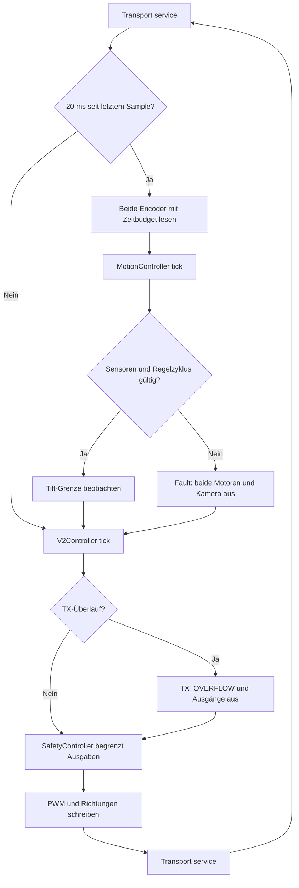
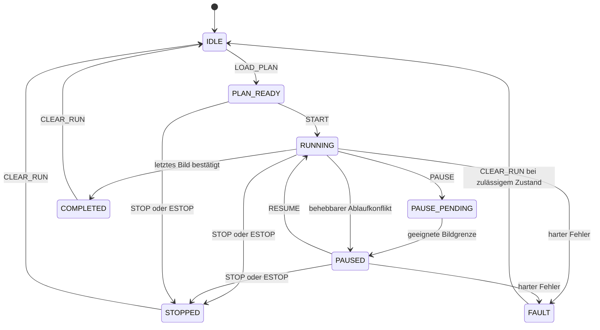

# 03 — Firmware PanoDuinoControl

[Inhalt](README.md) · [Android](04-android.md) · [Variablen](07-variablen-und-parameter.md)

Aktiver Sketch: `PanoduinoControlGitRepo/PanoDuinoControl/PanoDuinoControl.ino`. Versionsquelle: `VersionInfo.h`, derzeit **2.4.75 / 2026-10-23**. Die frühere monolithische Datei im Repository-Wurzelverzeichnis ist nicht der aktuelle Einstiegspunkt.

## Module und wichtige Funktionen

| Modul / Typ | Funktionen und Aufgabe |
|---|---|
| `PanoDuinoControl.ino` | `setup()` initialisiert Ausgänge, Encoder und V2; `loop()` bedient Transport, 20-ms-Sampling, Regler, Ablauf und begrenzte Ausgabe |
| Encoderzugriff im Sketch | `readAxis()`, `sampleEncoders()`, `recoverEncoderBus()` lesen, entrollen und prüfen I2C-Werte; begrenzte Bus-Recovery |
| `PanoHardwareAdapter` | Implementiert `IPanoramaHardware`; verbindet mdeg-Ziele, Tilt-Referenz, Regelung, Hardwareausgänge und Diagnose |
| `ProtocolV2` | Rahmen sammeln, ASCII-/Längen-/CRC-Prüfung, Sequenz-/Duplikatbehandlung, ACK/NACK und Ausgabe |
| `SerialTransport` | Gepufferter serieller Versand; R4-Ausgabe in kleinen Häppchen, Überlaufmeldung statt unbemerkter Blockade |
| `V2Controller` | `handleV2Frame()`, `tick()`, `sendStatus()`, `checkHeartbeat()`; Sitzungsbesitz, Kommandofreigaben, manueller Betrieb, Timelapse und Gerätemeldungen |
| `PanoramaPlanV2` | `validate()`, `targetFor()`, `totalImages()`, `shotsInBand()`; gleiche ganzzahlige Rezeptgeometrie wie in den Clients |
| `PanoramaExecutor` | `loadPlan()`, `start()`, `pause()`, `resume()`, `tick()`; Aufnahmephasen und Commit; `rewindColumns()`, `forwardColumns()`, `retryColumn()`, `updateTiming()` |
| `MotionProfile` | `plan()`, `evaluate()`; begrenztes quintisches Referenzprofil für Position, Geschwindigkeit und Beschleunigung |
| `MotionController` | `commandManual()`, `commandPositioning()`, `commandColumnReturn()`, `commandJogVelocity()`, `tick()`, `controlTravel()`, `passiveCaptureStable()` |
| `SafetyController` | `validateTarget()`, `validateManualTarget()`, `observeTilt()`, `limitDrive()`, `stopMotion()`; Grenzen und Freigaben |
| `MotionSettings` | Festkommaparameter und `validate()`; Werte- und Querbedingungen vor Anwendung prüfen |
| `MotionConfigStore` | `load()`, `save()`; zwei vollständige EEPROM-Slots mit Revision und Prüfsumme |
| `DebugEventLog`, `StackWatermark` | Begrenzter Ereignisring und Speichermessung; kein dauerhaftes vollständiges Capture-Archiv |
| `BenchDrive`, `BufferedPanTrace` | Spezielle Diagnose-Builds; kein regulärer Bedienweg der produktiven Bluetooth-Firmware |
| `TargetArrivalMonitor` | Historischer Ankunftsmonitor mit eigenen Tests; seine Konstanten sind nicht automatisch die R4-Reglertoleranzen |

## Regel- und Hauptschleife

Die 20 ms sind das angestrebte Abtastintervall, keine Garantie eines echtzeitfähigen Betriebssystems. Der Regler überwacht zu große Lücken selbst. Der I2C-Transfer hat auf R4 ein 2.000-µs-Timeout und für Lesen/Recovery ein gemeinsames 8.000-µs-Budget. Bei Lesefehlern werden beide Motoren sofort stromlos geschaltet; ein begrenzter Bus-Recovery-Versuch kann noch innerhalb desselben Budgets gültige Werte beschaffen. Danach weiterhin ungültige Sensoren führen zu `FAULT_PAN_SENSOR` oder `FAULT_TILT_SENSOR`.

Ein Sensor-Fault bezeichnet hier eine fehlgeschlagene, unvollständige oder nicht rechtzeitig abgeschlossene Messung. Er ist kein Synonym für eine große Soll-/Ist-Abweichung. Die Ursache des Feldfehlers vom 24.10. ist damit noch nicht elektrisch geklärt.

## Regler und Ankunft

Pan und Tilt besitzen getrennte Ziel-, Geschwindigkeits-, Integral-, Fortschritts- und Ruhewerte. Je Fahrart werden Profilregelung, gestufte Anlauf-/Fahrt-/Bremslogik und begrenzte Endannäherung verwendet. Gelernte beziehungsweise konfigurierte Reibungs- und Laufleistungen wirken richtungsabhängig. Pan-Zielfahrten haben eine eigene Vorhersage des Auslaufwegs; die kalibrierte Variante ist per Parameter aktivierbar.

Eine Achse durchläuft beispielsweise `DRIVE_START`, `DRIVE_CRUISE`, `DRIVE_BRAKE`, `DRIVE_SETTLE`, optional `DRIVE_FINE`. Diese Antriebsstufen sind von den globalen Aufnahmephasen und `MotionAxisPhase` zu unterscheiden. „Halten“ kann eine begrenzte Driftkorrektur umfassen; ein ausdrücklicher Stop deaktiviert die Bewegung.

Eine Ankunft erfordert passende Position, Geschwindigkeit und Verlaufsspanne über ein Zeitfenster. Eine einzelne passende Messung reicht nicht. Die Ruheschwelle, die erlaubte Zielabweichung und die Warnschwelle sind unterschiedliche Größen. Geschwindigkeit/Tempo begrenzt das Fahrprofil; es multipliziert nicht einfach die PWM.

Ab 2.4.74/2.4.75 wird eine knapp verfehlte Ankunft pro Achse vorgemerkt. Das beendet nicht mehr sofort die noch zulässige Fahrt der anderen Achse. Harte Sensor-, Grenz- und Kontrollfehler schalten weiterhin beide Achsen ab. Nach gemeinsamer Stillsetzung kann der Executor die reine Zielverfehlung als `STEP_TARGET_MISSED` kennzeichnen und am beruhigten Istort aufnehmen.

## Ablaufzustände

Das Diagramm zeigt die wesentlichen Bedienpfade, nicht jede im Code erlaubte Stop-/Fault-Transition. Manuelle Bewegung und Timelapse besitzen zusätzliche Controllerzustände; sie sind nicht weitere Werte des `RunStateV2`-Enums. `STATUS` kann den Timelapse-Betrieb gesondert melden.

## Begrenzte Wiederholung und Warnungen

`pauseRecoverable()` behandelt `MOTION_STALLED`, `MOTION_SETTLE_TIMEOUT`, `MOTION_FINE_TIMEOUT`, `MOVEMENT_TIMEOUT`, `MOTION_NOT_QUIET`, `CAPTURE_NOT_STABLE` und `EXPOSURE_UNSTABLE` abhängig von Phase und Sicherheitszustand. Vor einer noch unbestätigten Aufnahme ist für ausgewählte Bewegungsfehler genau ein automatischer Wiederholungsversuch am selben `nextImageIndex` möglich. Eine angeforderte Pause/Navigation hat Vorrang. `EXPOSURE_UNSTABLE` und `CAPTURE_NOT_STABLE` fallen nicht in diesen automatischen Bewegungs-Retry. Nach ausgeschöpftem Budget bleibt der Auftrag pausiert statt unbeschränkt weiterzufahren.

`RETRY_COLUMN` ist ein gesonderter Wiederholungsweg mit eigener Zustands-/Modusprüfung. Sensorfehler werden dadurch nicht automatisch ignoriert. Interne Rezeptfehler wie `TARGET_CALCULATION` und `INVALID_PHASE` bleiben harte Fehler.

## Sicherheits- und Speichergrenzen

| Schutz | Wirkung |
|---|---|
| Software-Endlagen | Zielvalidierung und begrenzte Ausgänge; Rückfahrt von außerhalb nur kontrolliert in den zulässigen Bereich |
| Sensorfehler / `CONTROL_TIMEOUT` | Motor- und Kameraausgabe aus |
| Kein Fortschritt / Umkehrbudget | Zeitlich begrenzte Fahrt, danach Retry/Pause oder Fault entsprechend dem konkreten Pfad |
| Passive Aufnahmestabilität | Vor und während Trigger/Belichtungswartezeit unabhängig von Zielgenauigkeit geprüft |
| Heartbeat | Bei Plan-Policy 1 nach Frist Stop; Policy 0 erlaubt autonomen Lauf ohne Client |
| Jog-Lease | Ohne Keepalive endet die gehaltene Fahrt; Token schützt vor veralteten Stop-/Keepalive-Kommandos |
| TX-Überlauf | `TX_OVERFLOW`; Diagnoseverkehr darf nicht unbemerkt die Regelung blockieren |
| Begrenzte Historie | R4 bis 64 Laufsegmente; alter Nano fünf. Fehlende historische Istwerte werden nicht erfunden |
| Maximaler Auftrag | 4.000 geplante Bilder; Wiederholungszähler und ursprüngliche Plangröße getrennt behandeln |

Persistiert werden Grenzen, Tilt-Nullpunkt, Bootkennung und Motorprofil. Der laufende Auftrag und die vollständige Aufnahmehistorie werden nicht als stromausfallsicheres Firmware-Langzeitarchiv gespeichert. Ein Neustart erfordert deshalb Referenz-/Sitzungsprüfung; das langfristige Journal liegt auf dem Client.

## Konfiguration und Buildvarianten

Der aktuelle Katalog umfasst **129** Parameter mit Schema 1. Protokoll und EEPROM speichern skalierte Ganzzahlen. `MotionSettings::validate()` prüft zusätzlich Hysterese, Leistungsgrenzen, Fenster und zulässige Kombinationen. `BEGIN_MOTION_CONFIG` → `SET_MOTION_PARAMETER` → `APPLY_MOTION_CONFIG` bildet eine geprüfte Konfigurationstransaktion; eine bloß akzeptierte Einzelzahl beweist noch keine gültige Gesamtkonfiguration. [Vollständige Referenz](referenz/motorparameter.md).

| Build | Zweck |
|---|---|
| Normal Nano R4 | Reguläre Bluetooth-Steuerung über `Serial1` |
| `PANODUINO_USB_CONTROL` | Expliziter USB-Prüfstand, anderer Hardware-Target-Name; keine normale Feldauslieferung |
| `PANODUINO_MOTION_TRACE` | Bluetooth-Steuerung mit zusätzlicher USB-Messausgabe |
| `PANODUINO_BUFFERED_PAN_TRACE` | Gepufferte Pan-Messspur; benötigt den expliziten Trace-Build |
| Host-Test | FakeArduino/Wire, reproduzierbare Fehler- und Regelmodelle |

Ein erfolgreicher Test-Build bestätigt nicht die Installation des regulären Bluetooth-Builds. Build und Flash sind getrennte Arbeitsschritte. [Buildanleitung](10-build-tests-und-wartung.md).
