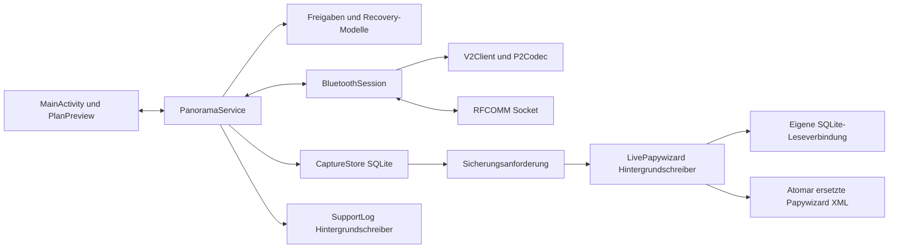
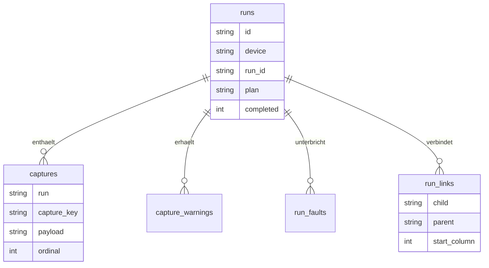

# 04 — Android-App

[Inhalt](README.md) · [Windows](05-windows.md)

**Version 0.6.26 / Code 39**, Paket `de.tomnaiser.panoramaandroid`. Java, native Android-Views, minSdk 26, compileSdk/targetSdk 35. Die App verwendet keine Weboberfläche.

## Blöcke und Nebenläufigkeit

`PanoramaService` besitzt die Verbindung unabhängig von einer Neuerstellung der Activity und wird bei aktiver Verbindung als Foreground-Service betrieben. Eingehende validierte Meldungen aktualisieren das Zustandsmodell und die Beobachter der Oberfläche. Bluetooth-Schreiben, dessen unabhängiger Watchdog, Diagnoselog und automatische XML-Sicherung sind vom UI-Dateischreiben getrennt. SQLite-Aufnahmeannahme selbst ist eine synchrone bestehende Speicheroperation; daraus folgt keine pauschale Garantie beliebiger UI-Latenz bei defektem oder überlastetem Speicher.

## Modul- und Funktionsübersicht

| Typ / Datei | Wichtige Funktionen und Verantwortung |
|---|---|
| `MainActivity` | UI aufbauen/rendern, Kameraprofile, Endpunkte, explizite Bedienaktionen, Wiederaufnahmedialoge, Dokumentexport |
| `PanoramaService` | `command()`, `loadPlan()`, `runCommand()`, `emergencyStop()`, `moveToUi()`, `beginJog()`, `endJog()`, `trigger()`, `recoverDevice()`; zentrale Gerätefreigaben |
| Service-Wiederaufnahme | `recoveryCheckpoint()`, `canPrepareRest()`, `prepareRest()` sowie `retryColumn()`; gespeicherten Auftrag prüfen und Fortsetzung vorbereiten |
| `DeviceState` | `accept()`, `validateTarget()`, Koordinatenumrechnung; bestätigter Status, Plan, Grenzen, Fähigkeiten und Aktualität |
| `BluetoothSession` | Socket öffnen/schließen, `HELLO`, Frame-Empfang, Heartbeat, Sitzungsfehler |
| `DeviceLink`, `DeviceSession` | Verbindungsschnittstelle und Gerätesitzungs-/Bootbehandlung; Tests können ohne echte Hardware anbinden |
| `V2Client` | `send()`, `emergencyStop()`, `stopJog()`, `heartbeat()`; genau ein wartendes Kommando, identische Retries, Schreibfrist |
| `P2Codec`, `FrameReader` | Kodieren/CRC/ASCII prüfen und Byte-Strom in vollständige Rahmen aufteilen |
| `CommandEffects` | Nur lesende von wirkungsverändernden Kommandos unterscheiden, damit Diagnosefehler keine erfundene Motorunsicherheit auslösen |
| `CameraProfile`, `PanoramaPlan` | Bildwinkel, Planberechnung, Parsing/Validierung, `fields()`, `target()`, `sameRecipe()` |
| `EndpointSelection`, `ManualTargets` | Bewusste Zielauswahl, Start/Ende und zulässige Rückfahrt |
| `JogHold`, `ManualActionStatus`, `ManualActionProgress`, `ManualMoveProgress` | Gedrückte Pfeile, Token/Keepalive, gemeldeten Aktionsabschluss und Zeitgrenzen verfolgen |
| `IncidentTracker`, `RecoveryFlow`, `ReconnectPolicy` | Vorfälle deduplizieren/quittieren, neue Anlässe unterscheiden, tatsächlichen Zustand neu prüfen |
| `PlanAbort`, `RestPreparation` | Mehrstufige Abläufe mit ACK plus frischen Zustandsbestätigungen; kein implizites START |
| `RasterRecovery`, `RunRecoveryPause` | Restspalten beziehungsweise sphärische Originalbänder und zulässige Fehler-/Pausefälle |
| `CaptureQualityGuard`, `CaptureWarning`, `CaptureStabilitySettings` | Qualitätsunterbrechung, Warnflags und separate gespeicherte Stabilitätsparameter |
| `CaptureStore` | `accept()`, `recordFault()`, `checkpoint()`, `linkRest()`, `exportLinked()`, `liveSnapshot()`; dauerhafte Capture-Identitäten und Verknüpfungen |
| `LivePapywizard` | `request()`, `rebuild()`, `atomicPublish()`; fortlaufend abgeschlossene XML aus SQLite |
| `PlanPreview`, `RunPlotModel`, `PlotViewport`, `PlotWorkspace` | Soll/Ist/erfasste Punkte, Warnmarkierung, Zoom, Verschieben und große Grafik |
| `SupportLog`, `StatusLogPolicy` | Begrenztes rotierendes Protokoll; Statusprotokollierung dosieren |

## Oberflächenbereiche

| Seite | Funktion |
|---|---|
| Gerät | Bluetooth-Gerät, Verbindung, Geräteinformation, Zustand und Freigaben |
| Manuell | Schritt-/Zielfahrt, Haltepfeile, getrennte Tempi, Einzeltrigger, Ausrichtung |
| Plan | Profil, Bildwinkel, Überlappung, Start/Ende, Raster-/Sphärenvorschau und Übertragen |
| Lauf | Aktiver Geräteauftrag, Fortschritt, Pause/Fortsetzen, Spaltennavigation, Warnungen, Wiederaufnahme |
| Extras | Timelapse, gespeicherte Läufe, XML/CSV/Unterbrechungen, Sicherungsstatus, Diagnose, Grenzen und Tilt-Referenz |

NOT-STOP und grundlegende Fahrbedienung werden auch bei großer Grafik zugänglich gehalten. Eine Zielmarkierung oder ein ACK verschiebt keinen gemessenen Istpunkt.

Ab 0.6.26 bietet **Extras → Sprache / Language** die gespeicherte Auswahl **Deutsch / English**, unabhängig von der Systemsprache. `PanoramaApplication` lädt die Auswahl vor UI und Service. `UiText` enthält die gemeinsamen Übersetzungen auch für JVM-testbare Modelle; sprachabhängige Zahlenformate betreffen nur die Anzeige. Protokollfelder, Koordinaten, Dateischemata und gespeicherte Eingabewerte bleiben sprachunabhängig. Ein Sprachwechsel erstellt die Activity neu und erhält Eingaben, Seite, Diagrammausschnitt und offene Zielauswahl. Der Foreground-Service behält Verbindung und Auftrag. Statuswerte werden bei ihrem Auftreten in beiden Sprachen erfasst und bei Bedarf neu angezeigt. Neue Vorfälle speichern beide Sprachfassungen; historische Logs und ältere Fehlerdetails bleiben in ihrer ursprünglichen Sprache.

## Freigaben und Kommunikation

Ein Bedienkommando benötigt je nach Funktion Verbindung, frischen Status, passende Fähigkeiten, bestätigte Grenzen, keine ungeklärte Befehlswirkung und einen passenden Geräte-/Aktionszustand. Fehlerdetails begründen eine Sperre. Eine seit mehr als fünf Sekunden ausgebliebene Statusaktualisierung führt zur Verbindungsfehlerbehandlung; kürzere Frischegrenzen sperren bereits Bedienaktionen.

Bluetooth-V2 verwendet 750 ms ACK-Frist und drei Wiederholungen nach dem ersten Versuch. Der Heartbeat läuft nach erfolgreichem Handshake alle 200 ms. Ein unabhängiger Schreib-Watchdog kann einen blockierten RFCOMM-Ausgabepfad durch Schließen genau dieser Sitzung abbrechen. Not-Stop verdrängt wartende normale Befehle. Wiederverbindung übernimmt den aktuellen Gerätestand und sendet nicht automatisch einen alten START- oder Fahrbefehl erneut.

## Dauerhafte Daten

`captures.db`, Schema **4**, ist die maßgebliche Langzeitgrundlage. SQLite ersetzt keinen Bildspeicher der Kamera.

| Tabelle | Inhalt |
|---|---|
| `runs` | Interne UUID, Geräteadresse, Geräte-Laufnummer, Zeitstempel, Plan, Segmente, abgeschlossener Zähler |
| `captures` | Stabiler Capture-Schlüssel, Originalpayload, Reihenfolge, manuell/regulär, lokaler UTC-Empfangszeitpunkt |
| `capture_warnings` | Warnflags pro regulärer Capture-Ordnungsnummer |
| `run_links` | Kind-/Elternlauf und Beginn des Restauftrags |
| `run_faults` | Fehler, Plan, Status, nächster Index, Bootkennung und Tilt-Referenz für Wiederaufnahme |

Das ER-Diagramm beschreibt logische Beziehungen; die SQL-Tabellen deklarieren nicht durchgängig entsprechende Foreign-Key-Constraints. Einstellungen und Kameraprofile liegen zusätzlich in SharedPreferences. Supportlogs sind begrenzt und können rotieren; ein vollständiges Aufnahmejournal darf nicht aus ihrem unbegrenzten Fortbestand abgeleitet werden.

## Wiederaufnahme nach Fault

Ab 0.6.24 bleiben auch Sensor-, Kontrollzeit-, Transport- und bewusste Stop-Fälle als Wiederaufnahmecheckpoint zugänglich. Das bedeutet keine Freigabe bei weiter defekten Sensoren. Bootkennung, Tilt-Referenz, Gerät, Rezept und Status müssen passen.

`RestPreparation` wartet nach einem nötigen STOP auf bestätigten Stillstand, nach CLEAR auf frisches IDLE und nach LOAD auf den exakten neuen Plan in PLAN_READY. Die Eltern-/Kindverknüpfung wird vor dem Laden reserviert. Ein App-Abbruch zwischen CLEAR und LOAD kann damit nachvollzogen werden. Der abschließende Start ist eine eigene Benutzeraktion. Bei sphärischen Rezepten erhält `RasterRecovery` die originalen ganzzahligen Bandziele.

## Laufende Papywizard-Datei

Ab **0.6.25** löst jeder relevante gespeicherte Plan-/Capture-/Rekonstruktionsstand eine Hintergrundsicherung aus. Die Datei enthält stets einen vollständigen XML-Rahmen; eine neue Fassung ersetzt die vorherige atomar. Ein Kindlauf einer Wiederaufnahme verwendet denselben Dateinamen wie der Ursprungslauf. Bei Schreibfehlern bleibt die vorherige Fassung erhalten, während neue Daten in SQLite gespeichert werden.

Auf dem Pixel: `/sdcard/Android/media/de.tomnaiser.panoramaandroid/Papywizard/`. Ohne externen Medienordner wird der angezeigte interne Ordner verwendet. Unter Extras kann der Benutzer weiterhin eine XML-/CSV-Kopie an einen frei gewählten Dokumentort schreiben.

Ein Prozessabbruch zwischen DB-Commit und XML-Aktualisierung kann die Datei hinterherhinken lassen. Beim nächsten Service-Start wird aus SQLite nachgezogen. Es gibt keinen gleichzeitigen atomaren Commit über Datenbank und Dateisystem. [Ausführlicher Befund und Nachweise (Zusammenfassung)](validation/README.md#papywizard-2026-10-24).

## Nicht abgedeckt

Keine automatische Bilddateiprüfung, kein Stitching, kein vollständiger GUI-Editor aller 129 Motorparameter und keine automatische Synchronisierung mit dem Windows-Archiv. Eine gute Simulation oder ein XML-Test ersetzt keinen Wind-/Last-/Bildschärfenachweis. Die zuletzt implementierten Extras-Texte wurden beim finalen 0.6.25-Update funktional über den Service, aber nicht erneut am entsperrten Display visuell geprüft.
