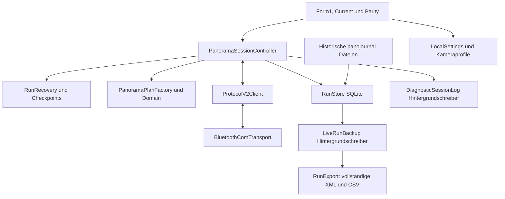

# 05 — Windows-App

[Inhalt](README.md) · [Protokoll](06-protokoll-und-datenmodell.md) · [Umsetzung und Prüfgrenzen 27.5.0](https://github.com/TomNaiser/PanoramaControl/blob/master/docs/history/WINDOWS-27.5.0-ANDROID-PARITAET.md)

**Version 27.5.4**, aktives Projekt `PanoramaControlGitRepo/PanoramaControl/PanoramaControl Version 27.csproj`. Windows Forms und .NET Framework 4.8 bleiben erhalten. Auslieferungsziel ist Windows 10/11 x64; SQLite verwendet die Systembibliothek `winsqlite3.dll`. Hosttests laufen unter .NET 8 mit Windows-Ziel, die tatsächliche Anwendung weiterhin unter .NET Framework 4.8.

27.5.4 ergänzt ausdrücklich wählbare Android-Referenzwerte für Zeiten/Tempo und wartet bei großen Diagnoseabrufen auf deren Ende. Nach den [ursprünglichen Vergleichsmessungen](https://github.com/TomNaiser/PanoramaControl/blob/master/docs/WINDOWS-27.5.4-PAN-VERGLEICH.md) wurde das gespeicherte Pan-Ankunftsfenster gezielt korrigiert: **Revision 40**, Pan 0,15°/0,25°, andere 127 Werte unverändert. **96 reale Aufnahmen** ergaben Pan maximal 0,236°, Median 0,089°; der 72er-Lauf enthielt 13 Zielverfehlungswarnungen. [Korrektur, neues Profilpaket und Grenzen](validation/2026-10-27-pan-positioning.md).

27.5.3 hält Android 0.6.27, reguläre Firmware 2.4.75 und das präzise Motorprofil Revision 39 als Referenz fest. Das Android-Praxisraster, pausierte Restaufträge und die Erhaltung der Gerätekonfiguration sind zusätzlich geprüft. [Referenzbedingungen, Paket und Grenzen](https://github.com/TomNaiser/PanoramaControl/blob/master/docs/WINDOWS-27.5.3-ANDROID-0.6.27.md).

27.5.2 ergänzt direkte Touchbedienung der Pfeile auf dem Surface; Überlappungsbeschriftung und Geräte-Tempolimit aus 27.5.1 bleiben korrigiert. Das Surface-Log belegt Pan-Gegenkorrekturen am unveränderten Ziel und unterschiedliche Aufnahmerezepte. Die physische Pan-Ursache ist noch offen; [Befunde und vorbereitete Messung](https://github.com/TomNaiser/PanoramaControl/blob/master/docs/history/WINDOWS-27.5.2-SURFACE-TOUCH.md).

## Architektur

| Modul | Verantwortung |
|---|---|
| `Form1.cs`, `.Current.cs`, `.Parity.cs` | Bestehende Hauptansicht, große Grafik, Maus-/Tastaturbedienung; Dialoge für Wiederaufnahme, Stabilität, Sicherung und Sprache |
| `PanoramaSessionController` mit `.Operations.cs` und `.Parity.cs` | Gerätesitzung, frische Statusdaten, zentrale Freigaben, Aufnahmeannahme, Checkpoints, Restvorbereitung und bestätigte Einstellungen |
| `ProtocolV2Client` | ACK/NACK, identische Retries, priorisierter Not-Stop, unabhängige Schreibfrist und Verwerfen alter Aufträge |
| `BluetoothComTransport` / `ISerialTransport` | Bluetooth-COM, Zeilenempfang, Abtrennen alter Portobjekte ohne Schließen einer neuen Sitzung |
| `PanoramaPlan`, `SphericalGeometry`, `CoordinateContract` | Deterministische Planung, Milligrad und Pan-/Tilt-Konventionen |
| `RunRecovery` | Restspalten/-bänder aus Originalrezepten; bei Sphäre exakte ganzzahlige Originalziele erhalten |
| `RunStore` / `SqliteDatabase` | Transaktionale Captures, Warnungen, Checkpoints mit Status-/Segmentkontext, Vorfälle und Laufverknüpfungen; wiederholbarer Journalimport |
| `LiveRunBackup` / `RunExport` | Automatische vollständige atomare XML, Neustart-Rebuild, gemeinsamer Export verknüpfter Läufe, feste CSV-Felder und Kameraorientierung |
| `DiagnosticSessionLog` | Begrenzte Hintergrundwarteschlange und Rotation pro Sitzung |
| `UiText` | Deutsche/englische Texte; Maschinenfelder und persistierte Zahlen bleiben sprachunabhängig |

Historische Klassen und das Version-26-Projekt sind keine neuen aktiven V2-Pfade. `RunArchive` bleibt für Journalimport und historische Kompatibilitätsprüfungen vorhanden; der alte inkrementelle Writer ist nicht mehr die maßgebliche laufende Dateisicherung der Oberfläche.

## Bedienung und Wiederaufnahme

Raster/Sphäre, getrenntes Übertragen/Starten, Profile, Haltepfeile mit Keepalive, Start-/Endpositionen, klassische Klicknavigation, Pause/Weiter, Spaltennavigation, Zeiten und Timelapse bleiben erhalten. Soll, Zielvorschlag, gemessene Istposition und rekonstruierte historische Werte bleiben unterscheidbar. Die Hauptanordnung der Form wurde beibehalten.

Bei einer Unterbrechung bleiben Originalrezept, Fortschritt, Fehler- und Referenzdaten im Archiv. **Gerätestand prüfen / quittieren** stellt die Bedienbarkeit nach einer frischen Zustandsprüfung wieder her. Ein erforderliches CLEAR löscht nicht zuvor ungesichert die lokale Wiederaufnahmegrundlage. Normales RESUME und ein neuer Restauftrag sind getrennte Abläufe.

Unter **Läufe & Warnpunkte → Restauftrag …** werden betroffene oder vorherige Spalte beziehungsweise Tilt-Band gewählt. Reservierung und Eltern-/Kindverknüpfung liegen vor CLEAR/LOAD dauerhaft vor. Die Vorbereitung bestätigt Stillstand, frisches IDLE und den exakt passenden Plan in PLAN_READY. Ein ACK allein reicht nicht. Anschließend startet nur die vorhandene Start-Aktion die Aufnahme. Ein abweichender Restplan wird weder als Reservierung übernommen noch für Start freigegeben.

Die Gerätezuordnung verwendet nach Möglichkeit die aus Windows aufgelöste Bluetooth-Adresse. Ohne eindeutige Zuordnung sowie bei anderer Bootkennung oder geänderter Tilt-Referenz bleibt der Restauftrag gesperrt. Nach einem App-Neustart wird eine begonnene Vorbereitung mit dem tatsächlichen Geräteplan abgeglichen; es gibt keinen automatischen START.

**Antrieb & Grenzen → Fahrt / Referenz / Warnungen …** ergänzt bestätigte Stabilitätswerte, optionale Qualitätspause über 1°, Rollwinkel und Deutsch/English. Stabilitätsschreiben nutzt die aktuelle Konfigurationsrevision und Rücklesen. Firmware-Fault, Warnschwellen und clientseitige Qualitätspause bleiben getrennt. Bei passender Fähigkeit kann ein erhaltenes pausiertes Raster eine Spaltenwiederholung vorbereiten; Bewegung folgt erst nach Weiter.

Sprachwechsel erneuert keine Sitzung und erhält Eingaben, Plan und Grafikausschnitt. Bestehende Protokolltexte bleiben in ihrer ursprünglichen Sprache. Aktuelle Beschriftungen und neue Meldungen werden in der gewählten Sprache dargestellt.

## Dateien und Export

| Ort | Zweck |
|---|---|
| `%LOCALAPPDATA%/PanoramaControl/settings-v2.xml` | Eingaben, Profile, Sprache, Qualitätsoption und Orientierung |
| `Runs/captures.db` unter demselben Basisordner | Maßgebliche neue Laufablage mit Checkpoints und Verknüpfungen; SQLite-WAL kann aktuelle Daten enthalten |
| `Runs/*.panojournal` | Unveränderte importierte historische Quellen |
| `Papywizard/Panorama_<Laufschlüssel>.xml` | Automatische vollständige XML je zusammengehörigem Panorama |
| `SupportLogs/` | Sitzungsdiagnose mit begrenzter Warteschlange und Rotation |
| `PanoControlConfig.xml` neben EXE | Bestehende Konfiguration, mit historischem Legacy-Fallback |

Nach gespeicherten Captures und Verknüpfungen wird im Hintergrund eine vollständige XML erzeugt, geflusht und atomar ausgetauscht. Dateisperren erhalten die letzte gültige Fassung. Der Sicherungsstatus nennt ausstehende Änderungen und Fehler; **XML neu sichern** wiederholt den Aufbau. DB-Commit und XML-Ersetzung sind getrennte Vorgänge. Beim Neustart werden noch nicht veröffentlichte Captures aus SQLite ergänzt.

**XML + CSV** exportiert alle verknüpften Teilläufe mit reproduzierbarer Bildnummerierung und eine `.interruptions.tsv` mit Fehler-/Statuskontext. Replay erzeugt keine Dubletten; echte Wiederholungsaufnahmen bleiben erhalten. Unbekannte historische Istwerte bleiben im CSV leer. Maschinenfelder und UTC-Zeitstempel sind sprachunabhängig.

Bestehende Profile behalten standardmäßig `roll=90`; für entsprechende Android-/Stitcherworkflows kann `roll=0` explizit gewählt werden. Gleiche Koordinaten allein beweisen keine passende Kameraorientierung. Alte Windows-Versionen lesen neue SQLite-Läufe nicht. Vor Sicherung der vollständigen Datenablage die App schließen oder eine konsistente SQLite-Sicherung einschließlich eines gegebenenfalls aktuellen WAL verwenden.

## Prüfung und verbleibende Grenzen

Die neuen Hostfälle prüfen Datenhaltung, Wiederaufnahme einschließlich Abbruch zwischen CLEAR und LOAD, sphärische Ganzzahlziele, falsche Gerätepläne, Dateisperren, Neustart-Rebuild, überlappende Exporter, Stabilitätsrevisionen, Qualitätspause und blockiertes Schreiben. WinForms-Prüfungen führen dieselbe native SQLite-Anbindung in der tatsächlichen .NET-4.8-Anwendung aus. Die alten Bedienprüfungen bleiben Bestandteil des Paketbuilds.

27.5.4 ist am Entwicklungsrechner über Bluetooth-COM mit dem regulären Kopf und Revision 40 in 96 realen Aufnahmen geprüft; der Paketbuild bestand 1.633 Softwareprüfungen. Noch offen sind die vollständige Surface-Bedienfolge, Wiederaufnahme nach einem neuen realen Fehler sowie Last-/Wind- und Bildqualitätsprüfung. Die feste Qualitätsschwelle beweist keine optische Mindestüberlappung; Capture-Zähler beweisen keine gespeicherten oder scharfen Kameradateien. Siehe [Prüfstand](validation/README.md), [Roadmap](09-probleme-und-roadmap.md) und den [Pan-Korrekturbericht](validation/2026-10-27-pan-positioning.md).
