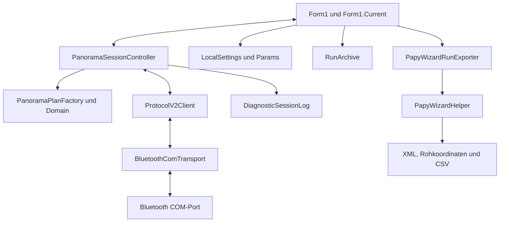

# 05 — Windows-App

[Inhalt](README.md) · [Protokoll](06-protokoll-und-datenmodell.md)

**Version 27.4.4**, aktives Projekt `PanoramaControlGitRepo/PanoramaControl/PanoramaControl Version 27.csproj`. Die Anwendung verwendet Windows Forms und .NET Framework 4.8. Die Host-Protokolltests sind ein separates .NET-8-Programm. Ein .NET-8-Testbuild macht die eigentliche WinForms-App nicht zu einer .NET-8-App.

## Architektur und Funktionen

| Modul | Rolle und wichtige Funktionen |
|---|---|
| `Form1.cs`, `Form1.Current.cs` | Bestehende Hauptansicht plus aktuelle Bedienung: Übertragen/Start, Fehler, Haltepfeile, Warnliste, Profile und große Grafik |
| `PanoramaSessionController` | Verbindung, Gerätestatus, aktiver Plan, Segmente, Ereignisrekonstruktion und asynchrone Befehlsfassade |
| `.Operations.cs` | `ReadinessReason`, `NavigationReason`, `RecoverAsync()`, `AbortPlanAsync()`, manuelle Aktion, Jog, Zeiten und Warnschwellen |
| `ProtocolV2Client` | `SendCommandAsync()`, priorisierter Not-Stop, ACK/NACK, identische Retries und serialisierte Ausgabe |
| `BluetoothComTransport` / `ISerialTransport` | COM-Port, Zeilenempfang, Fehler/Trennung; injizierbare Schnittstelle für Tests |
| `ProtocolFrameCodec`, `Crc16Ccitt` | V2-Rahmenvalidierung und CRC-16-CCITT-FALSE |
| `PanoramaPlanFactory`, `SphericalGeometry`, `PanoramaPlan` | UI-Eingaben in denselben Gerätevertrag wie Android/Firmware übersetzen |
| `CoordinateContract`, `AngleMdeg` | Pan-/Tilt-Vorzeichen und explizite Milligrad-Werte |
| `DeviceStatus`, `DeviceCapabilities`, `SessionFeatures` | Bestätigte Zustände, Limits, Frische und optionale Gerätefähigkeiten |
| `ManualMoveTargets`, `ManualActionProgress` | Zulässige Rückfahrt, getrennte Ziele und bestätigter manueller Abschluss |
| `RunSegmentResolver`, `RunEvent` | Zähler, Planrevisionen, echte Wiederholungen und rekonstruierte Einträge trennen |
| `RunArchive` | `SelectRun()`, `StorePlan()`, `Store()`, `Warn()`, `Snapshot()`; prüfsummengeschütztes Journal |
| `PapyWizardRunExporter` | `BeginRun()`, `TryExport()`, `CompleteRun()`; stabile Ereignisse deduplizieren und Bildnummern vergeben |
| `PapyWizardHelper` | Bestehender inkrementeller Dateiweg, Capture-Manifest und abschließende XML-Endtags |
| `DiagnosticSessionLog` | Lokales Sitzungsdiagnoseprotokoll |
| `Params`, `LocalSettings` | Bestehende XML-Konfiguration, persistente Eingaben/Profile und Referenzprüfung |

Historische Klassen wie `muControllerInterface` und `PanoramaAcquisitionClass` erklären frühere Kommunikations- und Ablaufpfade. Neue V2-Funktionen sind am SessionController zu verfolgen; das bloße Vorhandensein einer alten Klasse belegt keine aktuell aktive Funktion. Das Version-26-Projekt ist nicht das aktuelle Auslieferungsziel.

## Bedienumfang

Windows besitzt Raster- und sphärische Planung, aktuelle Pan-/Tilt-Abbildung, Planübertragung getrennt von Start, normale Pause/Fortsetzung, Spaltennavigation, laufende Zeitänderung, Timelapse, Einzeltrigger und Haltepfeile mit Keepalive/Stop. Fokusverlust, Loslassen und Schließen werden für die Handfahrt berücksichtigt. Start/Ende werden nach Beruhigung aus frischen Istwerten übernommen; Zielvorschlag und Istposition bleiben unterscheidbar.

Die große vorhandene Navigationsgrafik enthält Plan, Ziel, Ist, Aufnahmepunkte und Warnungen. Gespeicherte Läufe sind anzeigbar. Die späteren Windows-27.4.2/27.4.3-Anpassungen betreffen unter anderem Tilt-Ansicht, klassische Klicknavigation und automatische Rastervorschau nach geänderten Endpunkten. [Bediennachweise](https://github.com/TomNaiser/PanoramaControl/blob/master/docs/history/WINDOWS-27.4.3-RASTERVORSCHAU.md).

## Verbindung und Fehler

Der virtuelle COM-Port arbeitet mit 57.600 Baud. Sein Read-/Write-Timeout beträgt jeweils 500 ms. Seit 27.4.4 laufen serielle Writes außerhalb des UI-Threads und außerhalb der ACK-/Abbruchsperre; ein wartender Write blockiert damit nicht mehr den Aufruf der asynchronen Protokollroutine. Bereits verdrängte Befehle werden unmittelbar vor dem Schreiben erneut geprüft.

`ReadinessReason` sperrt Aktionen bei unfrischem Status, unbestätigten Grenzen, ungeklärter Wirkung, laufender manueller Aktion, Jog oder Fehler. `SessionFeatures` verarbeitet beispielsweise `MANUAL_STATUS`, Referenz-, Lauftempo- und Warnschwellenfähigkeiten. Die neueren Android-Pfade für `CAPTURE_STABILITY_SETTINGS` und die vollständige Restauftragsführung sind hier nicht portiert.

`RecoverAsync()` kann Not-Stop auslösen, frischen Status anfordern und einen Fault-/Stopped-Auftrag über `CLEAR_RUN` löschen, bevor Fähigkeiten und IDLE bestätigt werden. Das ist eine Wiederherstellung der Bedienbarkeit, keine Android-0.6.24-konforme Fortsetzung mit verknüpftem Restauftrag. Ein einfaches `RESUME` ist für normal pausierte gültige Aufträge implementiert; daraus folgt keine allgemeine Wiederaufnahme nach Sensor-Fault.

## Daten und Export

| Datei/Ort | Zweck |
|---|---|
| `%LOCALAPPDATA%/PanoramaControl/settings-v2.xml` | Aktuelle lokale Einstellungen und Profile |
| `%LOCALAPPDATA%/PanoramaControl/Runs/*.panojournal` | Laufarchive mit Capture-/Plan-/Warnrecords und Prüfsumme |
| `PanoControlConfig.xml` neben EXE | Bestehende Konfiguration; Legacy-Fallback `C:/PanoControlConfig.xml` |
| `PanoData<Zeitstempel>.xml` | Laufender klassischer Papywizard-Export im Arbeitsverzeichnis |
| `DataPanoData<Zeitstempel>.xml` | Historische Rohkoordinatendatei; trotz Dateiendung kein gleichwertiges Papywizard-XML |
| `CaptureManifest<Zeitstempel>.csv` | Zuordnung, Soll/Ist, Datenherkunft, Warnflags |

`RunArchive` identifiziert Läufe über Gerätehash, Bootkennung und Laufnummer. Prüfsummen und eine isolierende führende Leerzeile verhindern, dass ein abgebrochener letzter Schreibsatz beim Lesen als gültige erfundene Aufnahme gilt. Dies ist ein anderes Verfahren als Androids SQLite-Transaktionen; kein atomarer gemeinsamer Commit aller Windows-Dateien.

**Die laufende Windows-Papywizard-Datei ist noch nicht auf Android-0.6.25-Stand:** Header und Bilder werden inkrementell angehängt; die Endtags folgen in `ClosePositionDataXMLFiles()` über `CompleteRun()`. Bei Prozessabbruch kann das offene Live-XML daher unvollständig sein. Ein vollständiger Snapshot-Export aus dem Journal steht als eigener Exportweg zur Verfügung. Die automatische atomare Ersetzung nach jedem Capture wurde nur in Android ergänzt.

Auch XML-Details sind unterschiedlich: Android verwendet im aktuellen Export `roll=0`, der Windows-Legacy-Writer `roll=90` sowie einen älteren Zeitstempelstil. Eine Vereinheitlichung für jeden Kameraorientierungs-/Stitcherfall ist nicht durch die reine Koordinatenparität bewiesen.

## Prüfstand und Grenzen

27.4.4: 192 Protokoll-/Controller-Prüfungen und 115 simulierte WinForms-Prüfungen laut [datierter Abnahme](https://github.com/TomNaiser/PanoramaControl/blob/master/docs/history/WINDOWS-27.4.4-ROBUSTHEIT.md). Vorherige reale 27.4.0-Tests umfassten kurze Fahrten, Auslösung, Raster, Sphärenbänder, Pause/Zeiten und Verbindungswechsel; auch ein fehlgeschlagener Tilt-Fall ist dokumentiert. Sie sind kein Dauernachweis der Windows-Version 27.4.4 mit aktueller Firmware unter Windlast.

Windows wurde nach dem letzten Funktionsangleich bewusst zurückgestellt. [Aktuelle Unterschiede und fehlende Funktionen](08-funktionsstand.md), [nächste Windows-Arbeitspunkte](09-probleme-und-roadmap.md).
