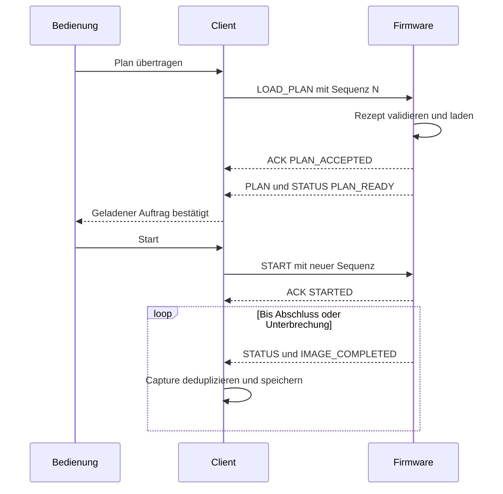

# 06 — Protokoll und Datenmodell

[Inhalt](README.md) · [Variablen](07-variablen-und-parameter.md)

## V2-Rahmen und Zuverlässigkeit

```text
@P2|sequence|messageType|field1|...|CRC16\r\n
```

ASCII, Trennzeichen `|`, keine Steuerzeichen in Nutzfeldern. Die Sequenz eines Clientkommandos liegt zwischen 1 und 65.535. CRC-16-CCITT-FALSE prüft den Text ab `@` bis vor das letzte `|`; das Prüffeld besteht aus vier Hex-Zeichen. Ein Client hält höchstens ein ACK-pflichtiges Kommando offen. Retries verwenden dieselben Bytes und dieselbe Sequenz. Eine neue Sequenz ist ein neuer Auftrag und darf nicht als sichere Wiederholung einer ungeklärten Aktion angenommen werden.

Die Firmware hält ein begrenztes Duplikat-/Ergebnisgedächtnis. Ein identisches wiederholtes veränderndes Kommando erhält dasselbe Ergebnis, ohne zweite Wirkung; anderer Inhalt unter derselben Sequenz wird abgelehnt. Das ist keine unbegrenzt persistente Transaktionshistorie über Firmware-Neustarts hinweg.



Bei verlorener Antwort ist der Retry derselben Sequenz sicherer als das Senden einer neuen Aktion. Ein ACK allein ersetzt nicht die im jeweiligen Ablauf geforderte frische Zustands- oder Planbestätigung.

## Aktuelle Größenlimits

| Stelle | Quellstand |
|---|---|
| Firmware RX alter AVR | `V2_MAX_FRAME_LENGTH=164` |
| Firmware RX R4 / Nicht-AVR | `V2_MAX_FRAME_LENGTH=220` |
| Firmware Felder | Maximal 20 |
| Android Codec RX/Encode | 256 Zeichen; ausgehende Kommandos zusätzlich auf 164 begrenzt |
| Windows Codec | Maximal 256; ein akzeptierter Codec-Rahmen ist dadurch noch nicht automatisch auf jedem Firmwareziel zulässig |
| R4 serieller TX-Puffer | 2.048 Byte; synchroner UART pro Transportdurchlauf höchstens acht Bytes |
| Alter Nano TX-Puffer | 128 Byte; erweiterte Bewegungsabnahme zielt auf R4 |

Die historische [Protokollspezifikation](../ProtocolV2.md) enthält weiterführende Felder und Beispiele, aber teilweise ältere Versions- und Grenzangaben. Für die aktuellen Zielunterschiede sind `ProtocolV2.h`, die Client-Codecs und dieses Kapitel maßgeblich.

## Kommandogruppen

| Kommandos | Nutzfelder / Aufgabe |
|---|---|
| `HELLO`, `HEARTBEAT` | Clientname beziehungsweise Laufnummer; Handshake und laufende Besitzerfrist |
| `GET_STATUS`, `GET_PLAN`, `GET_CAPABILITIES` | Keine Nutzfelder; bestätigten Gerätestand anfordern |
| `LOAD_PLAN` | 16 Raster- oder 18 sphärische Rezeptfelder, siehe nächste Tabelle |
| `START`, `PAUSE`, `RESUME`, `STOP` | Laufnummer; Zustandsübergang unter geräteseitiger Prüfung |
| `ESTOP` | Laufnummer und Grund; priorisiert, keine normale Besitzerfreigabe nötig |
| `CLEAR_RUN` | Keine Nutzfelder; zurückgesetzten Auftrag anschließend durch Status bestätigen |
| `REWIND_COLUMNS`, `FORWARD_COLUMNS` | Laufnummer, Spaltenanzahl; mit Planrevision/Segmentierung |
| `RETRY_COLUMN` | Laufnummer und Auswahl aktuell/vorher; eigene Prüfung des pausierten wiederholbaren Zustands |
| `UPDATE_TIMING` | Laufnummer, Beruhigungszeit, Triggerdauer, Belichtungswartezeit; gegebenenfalls bis Bildgrenze vormerken |
| `MANUAL_MOVE` | Pan-/Tiltziel in mdeg; bei Fähigkeit zusätzlich getrennte Pan-/Tilt-Tempi |
| `MANUAL_JOG_START`, `MANUAL_JOG_START_VELOCITY` | Token, Achse, Richtung, Tempo beziehungsweise Geschwindigkeit; Varianten entsprechend Fähigkeiten |
| `MANUAL_JOG_KEEPALIVE`, `MANUAL_JOG_STOP` | Token und protokollspezifische Folgenummer; alte Halteaktionen nicht mit neuer Fahrt verwechseln |
| `TRIGGER_ONCE` | Pulsdauer; Abschluss in manuellem Status und Aufnahmeereignis |
| `START_TIMELAPSE`, `STOP_TIMELAPSE` | Start: Laufnummer, Intervall, Pulsdauer; Stop: Laufnummer |
| `SET_TILT_LIMITS` | Wirksames Minimum/Maximum in mdeg; nur sicherer Stillstand und eingeschlossene Istposition |
| `SET_TILT_ZERO`, `RESET_TILT_ZERO` | Keine Nutzfelder; Referenz setzen/zurücksetzen, danach Entwurf neu prüfen |
| `GET_DIAGNOSTICS`, `GET_DEBUG_LOG`, `GET_SUPPORT_BUNDLE`, `CLEAR_DEBUG_LOG` | Diagnose; Logabfrage optional ab Sequenz, auf vollständiges `DEBUG_LOG_END` warten |
| `GET_MOTION_CONFIG` | Parameterindex; Antwort enthält Schema, Revision, Anzahl, Name, Wert, Skalierung, Einheit und Grenzen |
| `BEGIN_MOTION_CONFIG`, `SET_MOTION_PARAMETER`, `APPLY_MOTION_CONFIG`, `CANCEL_MOTION_CONFIG` | Token-/Revisionsgebundene Gesamtprofiltransaktion; alle Parameter vor Apply vollständig prüfen |
| `SET_CAPTURE_WARNING_TOLERANCE` | Pan-/Tilt-Warnschwelle und erwartete Konfigurationsrevision |
| `GET_CAPTURE_STABILITY`, `SET_CAPTURE_STABILITY` | Lesen oder atomar Spanne, Pan-/Tilt-Drift, zusätzliche Wartezeit und erwartete Revision schreiben |
| `BENCH_PULSE`, `BENCH_CRUISE`, `GET_BENCH_*` | Gesonderte Prüfstandsfunktionen; nicht als Feldbedienung des normalen Builds voraussetzen |

Das ist eine Funktionsreferenz, keine Aufforderung zum manuellen Senden von Motorbefehlen. Exakte Feldanzahl und Freigaben stehen in `V2Controller::handleV2Frame()` und `handleMotionConfiguration()`. Optionale Funktionen werden aus bestätigten Fähigkeitsmeldungen abgeleitet; ein Versionsstring allein ersetzt diese nicht.

## Vollständiges Planrezept

Die Positionen sind nullbasiert wie im Array `fields()`.

| Index | Protokollfeld | Typ/Einheit und Bedeutung |
|---:|---|---|
| 0 | `runId` | uint32 ungleich 0; Geräte-Auftragskennung |
| 1 | `planVersion` | 1 Raster, 2 sphärisch |
| 2 | `moveMode` | 0 Raster/Spaltenrückfahrt, 1 sphärisch |
| 3–4 | `startPanMdeg`, `startTiltMdeg` | Startziel in Gerätekoordinaten |
| 5–6 | `columns`, `rows` | Raster: Spalten/Reihen; sphärisch: maximale Bandbildzahl/Anzahl Tilt-Bänder |
| 7–8 | `stepPanMdeg`, `stepTiltMdeg` | Raster: vorzeichenbehaftete Schritte; sphärisch wird positiver Pan-Basisschritt für Bandgeometrie verwendet |
| 9 | `settleTimeMs` | 0…600.000 ms |
| 10 | `triggerPulseMs` | 1…60.000 ms |
| 11 | `exposureWaitMs` | 0…3.600.000 ms |
| 12–13 | `panSpeedPermille`, `tiltSpeedPermille` | 1…geräteabhängiges Maximum, derzeit bis 2.000 bei Freigabe |
| 14 | `disconnectPolicy` | 0 autonom weiter, 1 Heartbeat-Verlust stoppt |
| 15 | `heartbeatTimeoutMs` | Bei Policy 1: 500…60.000 ms |
| 16–17 | `endPanMdeg`, `endTiltMdeg` | Nur sphärisch; Endgrenzen der interpolierten Bänder |

Maximal 4.000 geplante Bilder. Alle berechneten Ziele müssen in den tatsächlichen Gerätegrenzen liegen. Gleiches Rezept mit neuer Laufnummer ist ein neuer Auftrag; Rezeptvergleich und Capture-Deduplizierung sind unterschiedliche Aufgaben.

## Antworten, Status und Aufnahmeidentitäten

| Meldung | Wesentliche Information |
|---|---|
| `ACK`, `NACK` | Anfrage-Sequenz und Ergebnis-/Fehlercode |
| `DEVICE_INFO`, `DEVICE_SESSION` | Firmware-/Protokoll-/Hardwarestand und Bootkennung |
| `CAPABILITIES`, `TILT_CALIBRATION` | Tatsächliche Grenzen, Bestätigung und Tilt-Referenz |
| `*_CAPABILITIES`, `CAPTURE_WARNING_SETTINGS`, `CAPTURE_STABILITY_SETTINGS` | Bestätigte optionale Freigaben und aktive Werte |
| `PLAN` | Aktuell geladenes Rezept; ältere leere Lauf-0-Meldung ist kein gültiger Auftrag |
| `STATUS` | Lauf, Zustand, Phase, `completed`, `total`, Ziel/Ist, Fehler, `nextImageIndex`, Revision und Segmentzähler |
| `RUN_SEGMENT` | Lauf, Planrevision, Startindex und gezählte Aufnahmen im Abschnitt |
| `IMAGE_COMPLETED` | 12 Felder: Ereignis, Lauf, Capture-Nummer, Revision, Bildindex, Spalte/Reihe, Soll-Pan/Tilt, Ist-Pan/Tilt, rekonstruiert |
| `MANUAL_IMAGE_TRIGGERED` | 8 Felder: Ereignis, Lauf, manuelle Capture-Nummer, Rasterzähler, Ist-Pan/Tilt, Gerätezeit, Replayflag |
| `MANUAL_STATUS` | Zugeordnete Aktion, Sequenz, Ergebnis und Abschluss-/Positionsinformationen |
| `CAPTURE_WARNING` | Lauf, reguläre Capture-Ordnungsnummer und Bitflags |
| `ACQUISITION_RETRY` | Erneuter Versuch am noch unbestätigten Punkt; kein zusätzlicher bestätigter Capture |
| `DIAGNOSTICS`, `MOTION_DIAGNOSTICS`, `STEP_TIMING` | Aktuelle Ruhe-/Regler-/Fahrzeitinformationen |
| `DEBUG_EVENT`, `DEBUG_LOG_END` | Begrenzte Ereignisaufzeichnung und Ende eines Diagnose-Snapshots |

`completed` zählt bestätigte reguläre Auslösungen, einschließlich echter Wiederholungen. `total` beschreibt die Plangröße. `nextImageIndex` bezeichnet den nächsten fachlichen Rasterpunkt; er ist nicht gleichbedeutend mit `completed`. Nach Spaltenrücksprung kann der Zähler die ursprüngliche Bildzahl überschreiten. Der 0-basierte Exportbildindex entspricht dem archivierten Aufnahmeablauf, nicht zwangsläufig dem originalen Rasterindex.

## Datenherkunft und Exportvertrag

Gemessene Einträge behalten Soll und Ist. Bei Empfangslücken dürfen bestätigte Zähler und Segmente fehlende Rasterereignisse rekonstruieren, aber keine historischen Istpositionen erfinden. Papywizard verwendet dann Zielkoordinaten; CSV kennzeichnet die Herkunft und lässt unbekannte Istwerte frei. Manuelle Aufnahmen können bei langen Verbindungslücken außerhalb des begrenzten Replay-Puffers fehlen.

Warnbits: 1 Pan-Abweichung, 2 Tilt-Abweichung, 4 begrenzte Fahrzeit erreicht, 8 Zielverfehlung. Ein Warnbit ist keine eigenständige Bestätigung optischer Unbrauchbarkeit und kein Ersatz für die Stabilitätsprüfung.

Android 0.6.25 schreibt gültige XML-Snapshots fortlaufend, Windows 27.4.4 hat einen inkrementellen Live-Writer und einen separaten vollständigen Archivexport. Bildnummern, Rollwert, Zeitstempelformat und Zusatzfelder nicht stillschweigend als bytegleich voraussetzen. Nach unsicherer Belichtung kann eine zusätzliche Kameradatei existieren, obwohl kein neuer Capture bestätigt wurde.
