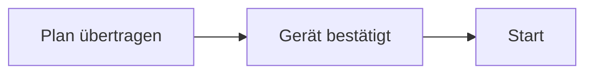

# 11 — GitHub, Mermaid und Pflege

[Inhalt](README.md)

## Mermaid auf GitHub

**Ja: GitHub rendert Mermaid direkt in Markdown-Dateien**, außerdem in unterstützten Kommentar-/Diskussionsflächen. Dazu dient ein normaler Codeblock mit Sprachkennung `mermaid`. Ein zusätzliches Bild-Hosting ist für diese Dokumentation nicht nötig. [Offizielle GitHub-Anleitung](https://docs.github.com/en/get-started/writing-on-github/working-with-advanced-formatting/creating-diagrams).

Beispielquelltext:

````markdown

````

Diese Dokumentation verwendet grundlegende Flowcharts, Zustands-, Sequenz- und ER-Diagramme. Keine Abhängigkeit von externen Bildern oder neueren Spezial-Shapes. Ein lokaler Markdown-Editor zeigt ohne Mermaid-Unterstützung unter Umständen nur den Quellblock; das bedeutet nicht, dass die GitHub-Darstellung fehlt. Die konkret von GitHub verwendete Mermaid-Version kann sich ändern; bei Syntaxfragen die offizielle Anleitung prüfen.

## Struktur für die spätere Veröffentlichung

`README.md` ist die englische Übersicht im Hauptrepository, `README.de.md` der deutsche Einstieg und `docs/README.md` das Inhaltsverzeichnis des ausführlichen deutschen Handbuchs. Das [englische Kurzmanual](en/manual.md) erklärt den Bedienablauf. Kapitel und fachliche Prüfergebnisse verwenden relative Links innerhalb des Hauptrepositorys. Verweise in die getrennten Unterprojekte verwenden deren GitHub-Adressen.

Firmware und Windows sind Git-Submodule mit eigenen Repositories und Lizenzen. Ein Push des Hauptrepositorys überträgt deren lokale Commits nicht automatisch. Für einen nachvollziehbaren veröffentlichten Stand müssen die im Hauptrepository referenzierten Unterprojekt-Commits auch im jeweiligen erreichbaren Remote vorhanden sein. Innerhalb eines Submoduls lassen sich lokale Dateipfade auf GitHub nicht wie normale Dateien im Elternrepository auflösen; deshalb nennt die generierte Quellreferenz zusätzlich die jeweiligen GitHub-Quelladressen. Diese zeigen auf `master` und sind nach Veröffentlichung auf Existenz zu prüfen beziehungsweise für Releases auf einen publizierten Commit zu fixieren.

Repositorys: [Firmware](https://github.com/TomNaiser/PanoDuinoControl), [Windows](https://github.com/TomNaiser/PanoramaControl). Android und die gemeinsame Dokumentation liegen direkt im Gesamtprojekt.

Die eigenen Inhalte des Hauptrepositorys einschließlich Android stehen unter [MIT](../LICENSE). Die vorhandenen LGPL-2.1-Lizenzbedingungen der Firmware und die MIT-Lizenz des Windows-Unterprojekts bleiben erhalten. Der Gradle Wrapper und weitere Fremdkomponenten behalten ihre eigenen Bedingungen; siehe [Lizenzzuordnung](../LICENSES.md).

## Was erzeugt beziehungsweise gepflegt wird

| Artefakt | Pflege |
|---|---|
| Kapitel 01–11 | Fachlich manuell; verändertes Verhalten und seine Prüfgrenze gemeinsam aktualisieren |
| `referenz/motorparameter.md` | Aus `MotionParameters.h` generiert; keine zweite handgepflegte Zahlenquelle |
| `referenz/quellcode.md` | Produktionsdateien, Typen, Pfade und Quellhashes generiert |
| `referenz/funktionen.md` | Automatisch erfasste Funktions-/Methodensignaturen als Suchhilfe, keine garantierte öffentliche ABI |
| `referenz/stand.json` | Versionen, Quellhashes und Umfang des zugrunde gelegten Quellstands |
| `validation/README.md` | Öffentliche Zusammenfassungen mit Version, Ergebnis und Nachweisgrenzen |
| Englischer Einstieg und Kurzmanual | Bedienung und Feature-Unterschiede gemeinsam mit den deutschen Kapiteln aktualisieren |

Die SHA-256-Quellhashes in `stand.json` ersetzen vor dem Hashen ausschließlich CRLF durch LF (`sourceHashNormalization: CRLF-to-LF`). Damit bleiben die Nachweise bei Windows- und Linux-Checkouts vergleichbar. Andere Inhaltsänderungen verändern weiterhin den Hash; es handelt sich nicht um Rohdatei-Hashes.

Generieren und prüfen, vom Repository-Wurzelverzeichnis:

```powershell
python docs/scripts/generate_reference.py
python docs/scripts/validate_docs.py
```

Die Python-Skripte benötigen nur die Standardbibliothek. Die Referenzerzeugung liest Produktionsquellen, verändert aber keine Anwendungsdatei. Die Signaturerfassung ist eine lexikalische Orientierung mit ausdrücklich dokumentierten Grenzen, kein vollständiger C++-/Java-/C#-Compiler.

Für echte lokale Mermaid-Renderprüfungen werden Node.js, Mermaid und Playwright benötigt. Der mitgelieferte Prüfer bekommt deren Pfade als Argumente, sodass keine persönliche Runtime-Adresse in der Dokumentation festgeschrieben wird:

```text
node docs/scripts/render_mermaid.cjs <Pfad-zu-mermaid/dist/mermaid.min.js> <Pfad-zum-playwright-Paket>
```

Eine Renderprüfung ändert keine Diagrammquellen. Erzeugte Prüfberichte, temporäre HTML-/SVG-/Bilddateien und zusätzliche Werkzeugpakete bleiben lokal und sind aus Git ausgeschlossen. Zum Lesen auf GitHub werden diese Werkzeuge nicht benötigt.

Nach einer Diagrammänderung meldet `validate_docs.py` zunächst den alten Renderbericht als überholt und schreibt trotzdem das neue Diagramminventar. Danach den Node-Prüfer und anschließend `validate_docs.py` erneut ausführen. So kann ein alter erfolgreicher Renderbericht keine inzwischen geänderte Zeichnung fälschlich bestätigen.

## Aktualisierung nach einer Codeänderung

Bei Änderung von Plan, Firmwarezustand oder Kommandofeld sind Funktionsbeschreibung, Variablen/Einheiten, Protokolltabelle und mindestens das betroffene Ablaufdiagramm gemeinsam zu prüfen. Bei Portierung einer Android-Funktion nach Windows auch die Matrix und die Liste offener Unterschiede ändern. Einen Softwaretest nicht als neuen Hardwarebeleg ausgeben.

Für die Pflege werden relative Links, Mermaid-Blöcke und Quellreferenzen geprüft. Die öffentliche Dokumentation enthält Produktbeschreibung, Bedienung, Architektur, Buildanleitungen, bekannte Einschränkungen und zusammengefasste fachliche Testergebnisse. Interne Repositoryverwaltung und ihre Berichte bleiben lokal.
