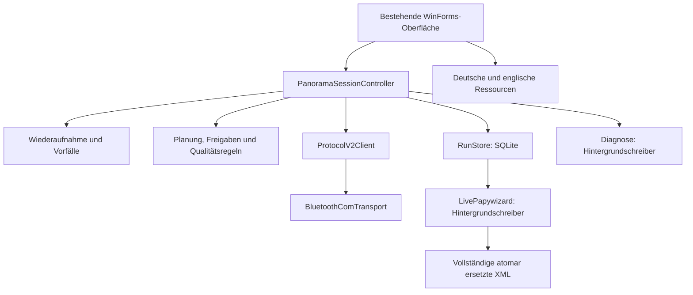

# Konzept: Windows technisch an Android angleichen

Stand: 25. Oktober 2026. **Vom Benutzer zur Implementierung freigegeben.** Der folgende Text hält das abgestimmte Konzept fest; die Umsetzung und ihre Prüfgrenzen stehen in den [Versionshinweisen zu Windows 27.5.0](https://github.com/TomNaiser/PanoramaControl/blob/master/docs/history/WINDOWS-27.5.0-ANDROID-PARITAET.md).

Verglichen wurden die lokalen Produktquellen von Windows **27.4.4**, Android **0.6.26 / Code 39** und die gemeinsame Dokumentation für Firmware **2.4.75**. Die Funktionsmatrix nennt noch Android 0.6.25; der Sprachumfang von 0.6.26 ist hier zusätzlich berücksichtigt. Dieses Konzept beschreibt geplantes Verhalten und verändert keine Produktfunktionen.

## 1. Ziel und Umfang

Windows erhält die technischen Fähigkeiten und wesentlichen Bedienmöglichkeiten der aktuellen Android-App. Hauptfenster, Register, große Navigationsgrafik, Maus-/Tastaturbedienung und gewohnte Aufnahmeplanung bleiben erhalten. Neue Funktionen erscheinen überwiegend in bestehenden Dialogen und im Bereich „Läufe & Warnpunkte“.

Die Angleichung betrifft Verhalten und Datenverlässlichkeit. Java und Android-Service werden nicht nachgebildet: Der vorhandene C#-Sitzungscontroller bleibt der Einstieg für die Windows-Oberfläche. WinForms und .NET Framework 4.8 bleiben zunächst bestehen. Ein Laufzeitwechsel wäre ein getrenntes Vorhaben mit eigener Kompatibilitätsprüfung.

Zum Umfang gehören Wiederaufnahme, dauerhafte Laufdaten, atomare XML-Sicherung, Stabilitäts- und Qualitätsfunktionen, robuste Sitzungsführung, Diagnose und Deutsch/Englisch. Firmwareänderungen, automatischer Archivaustausch zwischen Apps, vollständiger Motorparametereditor, Bildtransfer und Stitching gehören nicht zu dieser Angleichung.

## 2. Befund und Zielverhalten

| Bereich | Windows heute | Ziel |
|---|---|---|
| Grundbedienung | V2, Raster/Sphäre, Jog, Profile, getrenntes Übertragen/Starten, Pause, Zeiten und Timelapse vorhanden | Erhalten; gemeinsame Verhaltensfälle gegen Android absichern |
| Fehlerwiederherstellung | `RecoverAsync()` prüft Zustand und kann einen Fault-/Stopped-Auftrag löschen | Checkpoint vor dem Löschen sichern; Bedienbarkeit und Aufnahmefortsetzung getrennt führen |
| Wiederaufnahme | Kein gleichwertiger Restauftragsablauf | Betroffene/vorherige Spalte bzw. sphärisches Band wählen; Restauftrag laden; separat starten |
| Dauerhafte Daten | Prüfsummengeschützte `.panojournal`-Dateien | Transaktionale Ablage einschließlich Vorfällen, Checkpoints und Eltern-/Kindläufen |
| Laufende XML | Inkrementell; Endtags erst bei Abschluss; separater Snapshot möglich | Vollständige Fassungen im Hintergrund atomar veröffentlichen; nach App-Neustart neu aufbauen |
| Stabilität | Warnschwellen vorhanden; spezielle Stabilitätsparameter fehlen | Geräteeinstellungen lesen, validieren, ausdrücklich speichern und bestätigt anzeigen |
| Qualitätsunterbrechung | Warnpunkte vorhanden; Android-Qualitätsguard fehlt | Optionale Qualitätspause bei mehr als 1° Zielabweichung, getrennt von Warnschwellen und Firmware-Fault |
| Erhaltene Fehlerpause / Retry | Normaler Pausepfad vorhanden | Erhaltenen Auftrag und Firmware-Retry verständlich anzeigen; zulässige Wiederholungen anbieten |
| Transport | Asynchrone Writes, ACK/Retry und COM-Timeout vorhanden | Zusätzlich unabhängige Schreibfrist und Sitzungsinvalidierung prüfen/ergänzen; blockierte Writes dürfen Bedienung und Wiederverbindung nicht festhalten |
| Diagnose | Synchroner Logger; nach 5 MiB werden weitere Zeilen ausgelassen | Hintergrundschreiber, begrenzte Rotation und sichtbare Fehler; aktuelle Vorfälle bleiben nachvollziehbar |
| Sprache | Texte in Form und Controller überwiegend fest eingebaut | Gespeicherte Auswahl Deutsch/Englisch einschließlich Dialogen, Status und Sperrgründen |

Bereits vorhandene Fähigkeiten werden erweitert, nicht als fehlend neu implementiert. Insbesondere bestehen bereits ACK-/Retry-Deduplizierung, gemessene/rekonstruierte Datenherkunft, zentrale Bedienfreigaben und eine Trennung lesender von wirkungsverändernden Befehlen bei Timeout.

## 3. Technische Struktur

Der Controller nimmt Bedienaktionen an und liefert Zustand, Fortschritt und strukturierte Sperrgründe. Die Form rendert diese Informationen. Die Annahme und Speicherung von Aufnahmen wandert aus der Form in die Sitzung: Ein offener Dialog, eine Archivansicht oder eine andere Grafikgröße darf keinen Einfluss auf die Erfassung haben.

Die neuen Regeln liegen in wenigen Modulen mit kleiner Schnittstelle:

- **Wiederaufnahme:** bewertet Checkpoint und aktuellen Zustand, berechnet den Restplan und führt dessen Vorbereitung aus. Reine Geometrie-/Zustandsregeln bleiben ohne WinForms und Hardware prüfbar.
- **RunStore:** übernimmt Aufnahmen, Warnungen, Pläne und Vorfälle; reserviert verknüpfte Restaufträge; liefert konsistente Snapshots. SQLite-Details bleiben intern.
- **LivePapywizard:** nimmt Sicherungsanforderungen an, veröffentlicht Snapshots und meldet Sicherungsstatus. Ein echter Dateisystem-Adapter und ein fehlerinjizierbarer Test-Adapter nutzen dieselbe Schnittstelle.

Bestehende Plan-, Koordinaten- und Protokollmodule bleiben maßgeblich. Alte Version-26- und Legacy-Klassen werden nicht pauschal entfernt; aktive Aufrufpfade werden gezielt umgestellt.

## 4. Wiederaufnahme als vollständiger Ablauf

Für normale Pause, erhaltene Fehlerpause und Fault/Stop gelten unterschiedliche Abläufe. `RESUME` bleibt für einen zulässig pausierten, passenden Geräteauftrag möglich. Ein Fault wird dadurch nicht freigegeben.

1. Bei Unterbrechung werden Originalrezept, Fortschritt/Segmente, nächster Index, Fehlercode, Gerätezuordnung, Bootkennung, Tilt-Referenz und betroffene Aufnahme dauerhaft gesichert. Eine möglicherweise erfolgte unbestätigte Belichtung wird ausdrücklich gekennzeichnet.
2. Quittieren bestätigt nur den Vorfall. Die Zustandsprüfung bestätigt frische Status-, Grenz- und Referenzdaten. Soweit zur Wiederherstellung erforderlich, darf der Geräteauftrag erst nach gesichertem Checkpoint gelöscht werden.
3. Wiederaufnahme wird bei ungeklärter Wirkung, anhaltendem Fault, unklarer Gerätezuordnung, geänderter Bootkennung/Referenz oder unpassendem Rezept gesperrt. Der konkrete Grund bleibt sichtbar. Ein Controller-Neustart ist kein automatisch fortsetzbarer App-Neustart.
4. Der Benutzer wählt die betroffene oder vorherige Spalte; bei Sphäre das betroffene oder vorherige Tilt-Band. Der Dialog zeigt die tatsächlich verwendete Grenze und erwartete Wiederholungen.
5. Eine neue Laufkennung und Eltern-/Kindverknüpfung werden vor dem Laden dauerhaft reserviert. Die Vorbereitung wartet nach nötigem STOP auf bestätigten Stillstand, nach CLEAR auf frisches IDLE und nach LOAD auf den exakt passenden Plan in PLAN_READY. Ein ACK allein reicht nicht.
6. Erst die vorhandene Start-Aktion startet den Restauftrag. Wiederverbindung, Quittierung und Restvorbereitung senden keinen automatischen START.

Sphärische Restpläne übernehmen die ursprünglichen ganzzahligen Ziele. Wie bei Android muss die Schnittgrenze gegebenenfalls weiter zurückliegen, damit eine neue Interpolation keine Originalbreiten verändert. Das wird angezeigt, statt Bänder unbemerkt auszulassen oder die Planung aus Bildwinkel und Überlappung neu zu berechnen.

Abbruch oder App-Neustart zwischen Reservierung, CLEAR und LOAD bleiben anhand der gespeicherten Vorbereitung nachvollziehbar. Vor jedem weiteren Schritt wird der tatsächlich gemeldete Geräteplan abgeglichen; widersprüchliche Daten sperren den Ablauf.

## 5. Datenhaltung und Migration

**Empfehlung: SQLite als neue maßgebliche Laufablage.** Damit lassen sich Checkpoint und Restauftragsverknüpfung transaktional speichern. Eine Erweiterung des Journals wäre möglich, würde aber neue Regeln für zusammengehörige Schreibvorgänge und deren Wiederherstellung erfordern.

Vorgesehene Daten sind Läufe, Pläne/Revisionen, Captures, Warnungen, Vorfälle/Checkpoints, Restauftragsverknüpfungen und der Stand einer begonnenen Vorbereitung. Stabile Identitäten enthalten die lokale Laufidentität und die Geräte-Ereignisidentität. Replay wird dedupliziert; echte Wiederholungsaufnahmen bleiben eigene Aufnahmen. Gemessene Positionen haben Vorrang vor Rekonstruktionen; unbekannte Istwerte bleiben unbekannt.

Windows kennt bisher vor allem den COM-Port als Gerätezuordnung; `DeviceInfo` enthält keine eindeutige physische Geräte-ID. Für neue Daten soll nach Möglichkeit die Bluetooth-Geräteadresse des Ports aufgelöst und gespeichert werden. Wo dies nicht belastbar möglich ist, darf ein gleicher Portname nicht allein eine automatische Zuordnung zu einem alten Checkpoint begründen. Boot, Referenz und Rezept müssen zusätzlich passen; bei Mehrdeutigkeit bleibt Wiederaufnahme gesperrt.

Migration:

- Bestehende Journale bleiben unverändert erhalten. Der Import ist wiederholbar und über eine Importkennung gegen Dubletten geschützt; beschädigte Records werden mit Hinweis übersprungen.
- Bestehende Einstellungen und Kameraprofile werden übernommen. Historische Läufe bleiben anzeig- und exportierbar. Fehlende historische Boot-/Referenz-/Fehlerdaten werden nicht erfunden; solche Läufe erhalten keine neue automatische Wiederaufnahmefreigabe.
- Schemaänderungen und Import laufen transaktional. Importierte Anzahl, Warnflags und Datenherkunft werden vor der produktiven Umschaltung verglichen.
- Der SQLite-Provider wird in der ersten Implementierungsphase für die tatsächliche .NET-4.8-x64-Auslieferung und die Hosttests geprüft. Native Abhängigkeiten müssen im Paket enthalten sein. Dies ist eine technische Voraussetzung vor der Datenumstellung.

Ein einzelner geordneter Schreiber verhindert konkurrierende Datenänderungen; Exporte lesen konsistente Snapshots. Langsame Ablage darf den Protokollempfang nicht unbegrenzt stauen. Bei Fehler oder Überlast wird ein sichtbarer Archivfehler gemeldet und jede destruktive Wiederaufnahme gesperrt. Ein XML-Fehler und ein Fehler der maßgeblichen Datenablage sind unterschiedliche Zustände.

Rückfall: Das alte Programmpaket und die alten Journale bleiben nutzbar. Neue SQLite-Läufe werden von der alten App nicht automatisch verstanden; für sie stehen XML/CSV und ein Diagnoseexport bereit. Ein Programm-Rollback ist keine Rückmigration der Daten.

## 6. Laufende XML und Export

Nach erfolgreichem Speichern von Captures, Warnungen oder Laufverknüpfungen wird eine Sicherung angefordert. Ein Hintergrundschreiber fasst Anforderungen zusammen und erzeugt eine vollständig geschlossene Papywizard-Datei aus einem konsistenten Snapshot. Verknüpfte Restläufe gehören zum selben logischen Panorama; Nummerierung und Reihenfolge bleiben reproduzierbar. Echte Wiederholungen dürfen nicht als Replay verschwinden.

Die Datei entsteht zunächst im selben Verzeichnis als temporäre Fassung, wird geschrieben und geflusht und anschließend mit einer passenden Windows-Dateioperation atomar ersetzt. Bei gesperrter Datei, fehlendem Platz oder fehlender Unterstützung bleibt die letzte gültige Fassung bestehen; es gibt keinen stillen Rückfall auf Überschreiben einer offenen XML. Dateisystem und Austauschverhalten werden im Auslieferungsziel geprüft.

Beim App-Start wird aus der Datenablage nachgesichert, auch für leere Pläne und unvollständige Restvorbereitungen. Die Oberfläche zeigt Zielpfad, letzten erfolgreichen Sicherungsstand, ausstehende Änderungen und Fehler sowie „Sicherung erneut erstellen“. Die DB-Transaktion und die XML-Ersetzung sind keine gemeinsame Transaktion; der Sicherungsstand macht diese Verzögerung sichtbar.

Live- und manueller Export verwenden denselben Serializer. CSV erhält eine feste, sprachunabhängige Struktur einschließlich Datenherkunft, Warnflags und Laufverknüpfung. Die Kameraorientierung wird explizit im Exportprofil geführt: Der bisherige Windows-Wert `roll=90` darf nicht unbemerkt durch Androids `roll=0` ersetzt werden. Bestehende Profile behalten ihre Orientierung; bei gleicher Orientierung müssen gemeinsame Referenzfälle gleiche Koordinaten und Zuordnungen erzeugen. Zeitwerte werden eindeutig als UTC ausgegeben.

## 7. Stabilität, Vorfälle und Transport

Stabilitätseinstellungen umfassen Spanne, Pan-/Tilt-Drift und zusätzliche passive Wartezeit. Das Modell übernimmt Androids Einheiten und Wertebereiche; Schreiben nutzt die bestätigte Konfigurationsrevision und anschließendes Rücklesen. Eine lokale Eingabe wird nicht bereits als Gerätewert angezeigt. Die Bedienung erscheint nur bei passender Gerätefähigkeit.

Warnschwellen, die optionale clientseitige Qualitätspause über 1° und harte Firmware-Faults bleiben getrennt. Die Qualitätspause bewertet reguläre gemeldete Aufnahmen, dedupliziert denselben Anlass und startet keine eigene unbegrenzte Motorwiederholung. Firmware-Retry und erhaltene Pause werden anhand bestätigter Geräteinformationen dargestellt. Quittierte alte Vorfälle dürfen neue Ursachen nicht unterdrücken.

Für Transport und Nebenläufigkeit gelten: Schreibfrist unabhängig vom blockierenden Write überwachen; bei Fristablauf genau die betroffene Sitzung ungültig machen; verspätete Antworten und alte Schreibaufträge aus vorherigen Sitzungen verwerfen. ACK-Frist und identische Retries bleiben erhalten. Not-Stop behält Priorität, ohne auf die normale Befehlsschlange zu warten. Bei physisch blockiertem Transport ist seine Zustellung nicht garantiert; dies muss als ungeklärter Zustand behandelt werden.

Statusfrische wird unabhängig vom Rendern der Form überwacht. Bei Wiederverbindung wird erst der tatsächliche Gerätestand übernommen. Die bestehenden Stop-/Weiterlauf-Policies bleiben erhalten. Diagnose-I/O läuft separat mit begrenzter Warteschlange und Rotation; Capture-Daten werden nicht aus Supportlogs rekonstruiert.

## 8. Sichtbare Änderungen am bisherigen UI

| Bestehender Ort | Geplante Ergänzung |
|---|---|
| Hauptfenster und große Grafik | Layout und Interaktionen erhalten; kurze Wiederaufnahme-/Sicherungsanzeige im vorhandenen Statusbereich; NOT-STOP weiterhin erreichbar |
| Vorfalldialog „Gerätestand prüfen“ | Ursache, erhaltene Aufnahmen und Sperrgrund; nach erfolgreicher Prüfung Auswahl für Restauftrag; kein impliziter Start |
| Laufbedienung | Normales Fortsetzen und Restauftrag unterscheidbar; vorhandene Start-Aktion bleibt maßgeblich |
| „Fahrt, Referenz und Warnungen“ | Stabilitätswerte und optionale Qualitätspause ergänzen; bei Bedarf Unterregister/Scrollbereich |
| „Läufe & Warnpunkte“ | Zusammengehörige Teilläufe, Unterbrechungen, XML-/CSV-Export und Sicherungsstatus anzeigen |
| Einstellungen | Deutsch/English speichern; Texte am bestehenden Fenster aktualisieren, ohne Controller oder Verbindung neu zu erzeugen |

Sprachwechsel erhält Eingaben, Plan, Grafikansicht, Zielauswahl und Verbindung. Maschinenwerte und persistierte Zahlen bleiben sprachunabhängig. Neue Vorfälle speichern Codes und Parameter, damit ihre Darstellung übersetzbar ist; historische Freitexte bleiben unverändert. Längere englische Texte werden innerhalb der bestehenden Bedienstruktur auf Abschneiden geprüft.

## 9. Umsetzung in abnehmbaren Schritten

| Schritt | Ergebnis | Abnahme vor dem nächsten Schritt |
|---|---|---|
| 1. Bestand und Speichergrundlage | Vorhandene Prüfungen als Ausgangspunkt; SQLite-Paketnachweis, RunStore und Journalimport; Capture-Annahme an die Sitzung anbinden | Bestehende Abläufe erhalten; Import ohne Dubletten oder erfundene Daten; DB-/Paketstart auf sauberem Zielsystem |
| 2. Live-Sicherung | Ein Serializer, vollständige atomare XML, Sicherungsstatus und Neustart-Rebuild | Prozessabbruch, Dateisperre und verknüpfte Testdaten; letzte gültige XML bleibt lesbar |
| 3. Wiederaufnahme | Checkpoints, Vorfälle, Restberechnung und schrittweise Vorbereitung; bestehende Recovery-Pfade ersetzen | Raster/Sphäre, abweichende Referenz/Bootkennung und Abbruch an jeder Übergangsstelle |
| 4. Stabilität und Sitzungsrobustheit | Geräteeinstellungen, Qualitätspause, erhaltene Fehlerpause, unabhängige Schreibfrist und Diagnose | Revisionskonflikte, neue Vorfälle nach Quittierung, blockierter Transport und verspätete Antworten |
| 5. Sprache und Gesamtabnahme | Deutsch/Englisch, minimale UI-Ergänzungen, Dokumentation und Windows-Paket | Bestehende Bedienung bei beiden Sprachen; gezielte reale Prüfung der aktuellen Kombination |

Speicher-, Wiederaufnahme- und Exportmodule werden in den vorhandenen Protokoll-/Controller-Tests geprüft. Bestehende WinForms-Smokeprüfungen werden um die betroffenen Dialoge ergänzt. Gemeinsame sprachunabhängige Beispieldaten prüfen die Android-/Windows-Verhaltensparität, insbesondere Milligrad-Rundung und echte Wiederholungen.

Entscheidende Abnahmefälle sind: App-Abbruch zwischen Capture-Commit und XML-Ersetzung; Abbruch vor/nach CLEAR und LOAD; kein automatischer START; blockiertes Schreiben mit gleichzeitigem Stop; Boot-/Referenzwechsel; mehrere Restläufe ohne Exportdubletten; keine Veränderung des gespeicherten Laufs durch Sprach- oder Ansichtswechsel.

Reale Kurzprüfungen umfassen Jog/Fokusverlust, Aufnahme, Pause, Neuverbindung und Wiederaufnahme mit aktueller Firmware sowie die Zuordnung von Kameradateien zum Export. Sie erfolgen als eigener beaufsichtigter Prüfschritt. Softwaretests belegen keine Bildschärfe, elektrische Sensorursache oder allgemeine Fehlerquote unter Wind.

## 10. Entscheidungen dieses Vorschlags

Zur Abstimmung stehen damit ein zusammenhängender Umfang und drei zentrale technische Empfehlungen: **bestehendes WinForms-UI und Laufzeit zunächst erhalten**, **SQLite mit schonendem Journalimport einführen**, **Androids Wiederaufnahme- und Sicherungsverhalten einschließlich Deutsch/Englisch übernehmen**. Die Umsetzung beginnt nach Abstimmung dieses Konzepts mit Schritt 1.

## Quellgrundlage

- Windows: [Sitzungsoperationen](https://github.com/TomNaiser/PanoramaControl/blob/master/PanoramaControl/Application/PanoramaSessionController.Operations.cs), insbesondere `RecoverAsync()`, `ReadinessReason` und `RequestFreshStatusAsync()`; [Form1.Current](https://github.com/TomNaiser/PanoramaControl/blob/master/PanoramaControl/Form1.Current.cs), insbesondere `ArchiveCapture()`, `ShowIncident()` und `AttemptRecoveryAsync()`.
- Windows-Daten/Export: [RunArchive](https://github.com/TomNaiser/PanoramaControl/blob/master/PanoramaControl/Application/RunArchive.cs), [PapyWizardRunExporter](https://github.com/TomNaiser/PanoramaControl/blob/master/PanoramaControl/Application/PapyWizardRunExporter.cs), [SessionFeatures](https://github.com/TomNaiser/PanoramaControl/blob/master/PanoramaControl/Domain/SessionFeatures.cs), [DiagnosticSessionLog](https://github.com/TomNaiser/PanoramaControl/blob/master/PanoramaControl/Application/DiagnosticSessionLog.cs).
- Android: [PanoramaService](../PanoramaAndroid/app/src/main/java/de/tomnaiser/panoramaandroid/PanoramaService.java), insbesondere `canPrepareRest()`, `prepareRest()` und `recoveryGuidance()`; [RasterRecovery](../PanoramaAndroid/app/src/main/java/de/tomnaiser/panoramaandroid/RasterRecovery.java), [RestPreparation](../PanoramaAndroid/app/src/main/java/de/tomnaiser/panoramaandroid/RestPreparation.java), [CaptureStore](../PanoramaAndroid/app/src/main/java/de/tomnaiser/panoramaandroid/CaptureStore.java) und [LivePapywizard](../PanoramaAndroid/app/src/main/java/de/tomnaiser/panoramaandroid/LivePapywizard.java).
- Android-Qualität: [CaptureStabilitySettings](../PanoramaAndroid/app/src/main/java/de/tomnaiser/panoramaandroid/CaptureStabilitySettings.java), [CaptureQualityGuard](../PanoramaAndroid/app/src/main/java/de/tomnaiser/panoramaandroid/CaptureQualityGuard.java), [RunRecoveryPause](../PanoramaAndroid/app/src/main/java/de/tomnaiser/panoramaandroid/RunRecoveryPause.java).
- Einordnung: [Windows-Architektur](05-windows.md), [Android-Architektur einschließlich Sprache](04-android.md), [Funktionsmatrix](08-funktionsstand.md), [offene Nachweise](09-probleme-und-roadmap.md).
